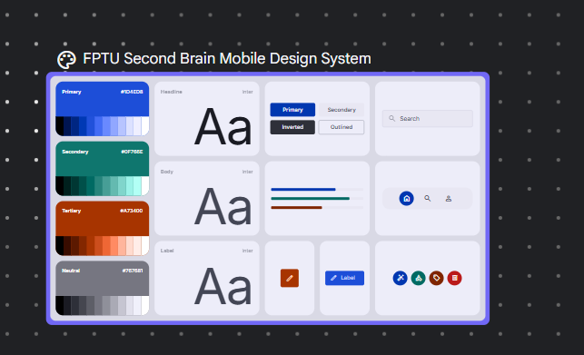
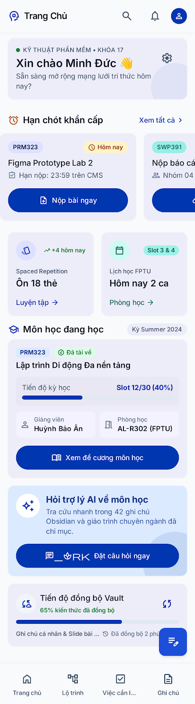
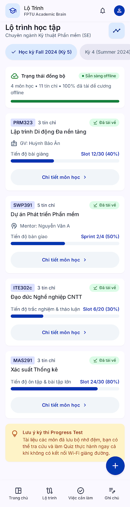
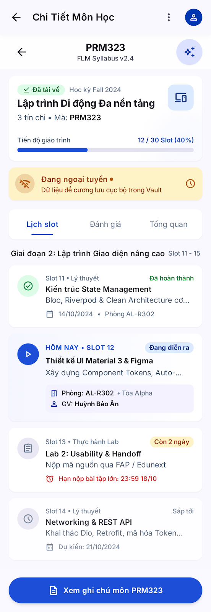
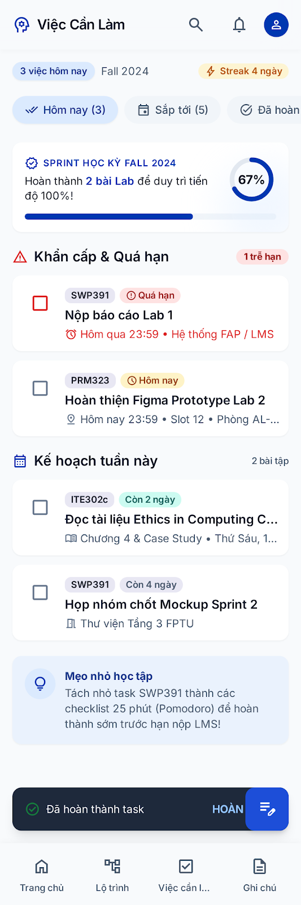
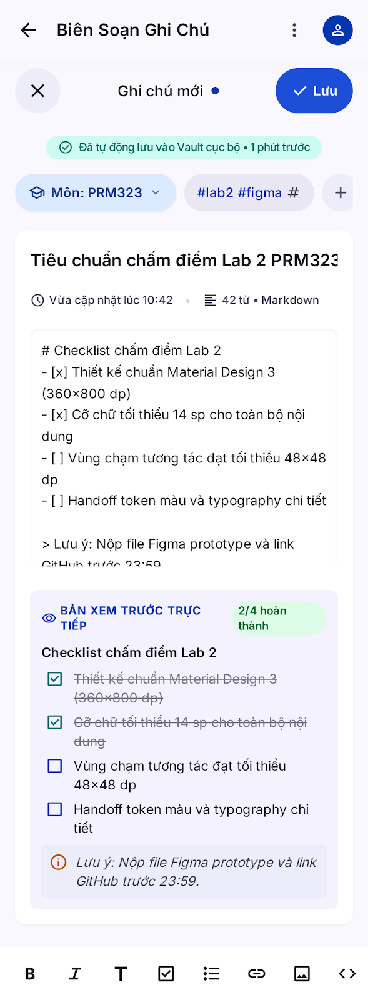
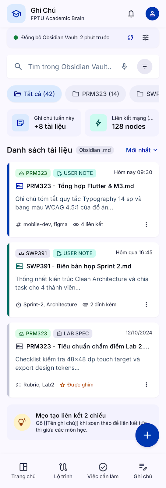
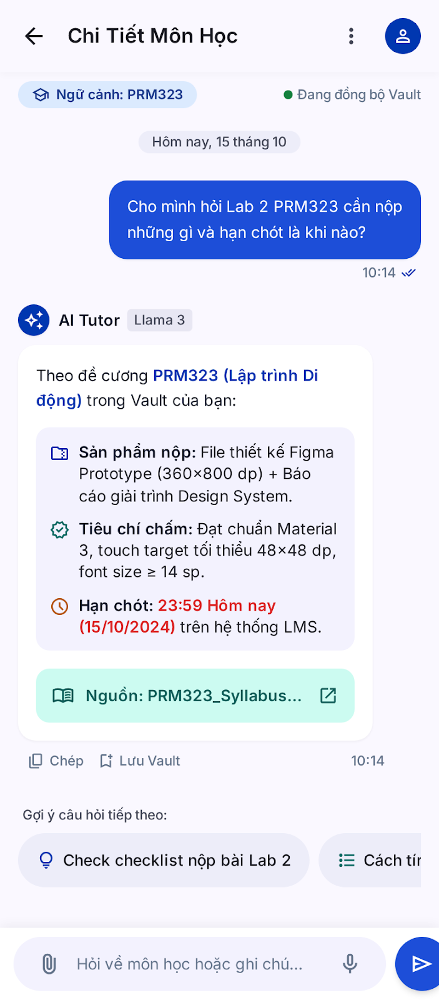
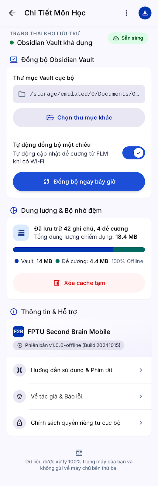

# AI DESIGN LOG: QUÁ TRÌNH TẠO VÀ TINH CHỈNH UI VỚI AI

Tài liệu này ghi lại toàn bộ quá trình làm việc với công cụ tạo giao diện bằng AI (Google Stitch) và trợ lý AI phản biện theo đúng quy trình bắt buộc tại Mục 4 và Mục 5 của đề bài Lab 2.

- **Dự án:** FPTU Second Brain Mobile (Ứng dụng đồng hành cho sinh viên SE Đại học FPT)
- **Persona:** Nguyễn Minh Đức (20 tuổi, SV SE, thao tác một tay trên xe bus, mạng chập chờn)
- **Công cụ AI sử dụng:**
  - **Google Stitch:** Tạo UI ban đầu và thực hiện các vòng lặp tinh chỉnh giao diện.
  - **Trợ lý AI phản biện độc lập:** Đánh giá UX theo 10 Usability Heuristics (Nielsen), tiêu chuẩn Accessibility (WCAG 2.1 AA) và Persona.

---

## 1. Thiết lập Ngữ cảnh & Khởi tạo Design System trong Google Stitch

Dự án sử dụng tính năng nạp trực tiếp tài liệu quy chuẩn **`design/DESIGN.md`** vào Stitch để trích xuất và cố định hệ thống Design System ngay từ đầu.

### 1.1. Phương thức Thiết lập
1. **Nạp Design Spec:** Chọn `Start with your design` trong Stitch và nạp toàn bộ nội dung từ file `design/DESIGN.md`.
2. **Trích xuất Design System:** Stitch tự động phân tích và tạo bộ quy chuẩn `FPTU Second Brain Mobile Design System` gồm:
   - **Bảng màu:** Cố định `Primary Blue` (`#1D4ED8`), `Secondary Teal` (`#0F766E`), nền sáng `Surface` (`#F8FAFC`).
   - **Typography:** Khóa font chữ `Inter` hỗ trợ đầy đủ tiếng Việt có dấu.
   - **Component Styles:** Nút bấm bo tròn `radius-full`, Card bo góc `radius-md`, thanh tìm kiếm và App Bar theo chuẩn Material Design 3.

### 1.2. Bằng chứng Trích xuất Design System từ Stitch


*(Ảnh chụp màn hình bảng Design System do Google Stitch tự động trích xuất thành công từ file `design/DESIGN.md`)*

---

## 2. Tạo UI Ban Đầu (Initial UI Generation) - Toàn bộ 8 Màn hình

### 2.1. Prompt Nguyên văn gửi Google Stitch
Prompt tạo đồng thời 8 màn hình hệ thống bao phủ trọn vẹn Kiến trúc thông tin và 3 User Flows:

```text
Thiết kế toàn bộ hệ thống 8 màn hình cho ứng dụng di động Android mang tên "FPTU Second Brain Mobile" dành cho sinh viên ngành Kỹ thuật Phần mềm.

Quy tắc thiết kế cốt lõi (Material Design 3):
- Khung màn hình: 360 x 800 dp.
- Giao diện: Toàn bộ sử dụng Giao diện SÁNG (Light Theme), nền chính #F8FAFC, bề mặt Card #FFFFFF, xanh dương chủ đạo #1D4ED8, xanh Teal phụ #0F766E, nền cảnh báo #FEF3C7, nền lỗi #FEE2E2. Tuyệt đối không dùng Dark mode, không dùng phong cách Cyberpunk neon.
- Typography: Phông chữ Inter, toàn bộ chữ nội dung bắt buộc >= 14 sp. Chiều cao dòng thoáng để hiển thị rõ dấu tiếng Việt.
- Công thái học cảm ứng: Các vùng tương tác (nút bấm, checkbox, chip lọc, icon tab) phải đạt diện tích chạm tối thiểu 48 x 48 dp.
- Thanh điều hướng đáy (Bottom Navigation Bar 80 dp) cố định trên 4 màn hình chính cấp cao nhất: Trang chủ, Lộ trình, Việc làm, Ghi chú.

DANH SÁCH 8 MÀN HÌNH CHI TIẾT:

1. SCR-01.01: Trang chủ (Dashboard)
- Top App Bar (56 dp): Tiêu đề "Kỹ thuật Phần mềm", icon Cài đặt ở góc phải (48x48 dp) dẫn đến SCR-08.
- Phần 1 (Carousel hạn chót khẩn cấp): Danh sách cuộn ngang tối đa 3 thẻ cho các việc có hạn <= 3 ngày. Mỗi thẻ hiển thị: mã môn "PRM323", tên việc "Figma Prototype Lab 2", huy hiệu gồm icon đồng hồ + chữ "Hôm nay" (nền vàng #FEF3C7, chữ #92400E). Nút chữ "Xem tất cả" căn phải.
- Phần 2 (Thẻ môn gần đây): Thẻ hiển thị "PRM323 - Lập trình Di động Đa nền tảng", tiến độ "Slot 12/30", nút "Xem đề cương".
- Phần 3 (Banner trợ lý AI): Nền xanh nhạt #DBEAFE, chữ "Hỏi trợ lý AI về môn học", icon auto_awesome, nút chính "Đặt câu hỏi".
- Phần 4: Thanh tiến độ đồng bộ Vault 65%.
- Bottom Navigation Bar (80 dp): Tab "Trang chủ" đang chọn. FAB tròn (56x56 dp) ở góc phải đáy với icon cây bút ghi chú.

2. SCR-02.01: Lộ trình môn học (Timeline / Semester Courses)
- Top App Bar: Tiêu đề "Lộ trình học tập", chip chọn kỳ "Học kỳ Fall 2024 (Kỳ 5)" [Đang chọn].
- Thống kê tóm tắt: Thẻ thông tin "4 môn học • 11 tín chỉ • 100% đã tải đề cương offline".
- Danh sách môn học dạng thẻ dọc:
  * Môn 1: "PRM323 - Lập trình Di động Đa nền tảng" (3 tín chỉ), tiến độ Slot 12/30, huy hiệu "Đã tải về" (xanh lá #DCFCE7).
  * Môn 2: "SWP391 - Dự án Phát triển Phần mềm" (5 tín chỉ), tiến độ Sprint 2/4.
  * Môn 3: "ITE302c - Đạo đức Nghề nghiệp CNTT" (3 tín chỉ), tiến độ Slot 6/20.
- Bottom Navigation Bar: Tab "Lộ trình" đang chọn.

3. SCR-02.02: Chi tiết môn học (Course Details / FLM Syllabus)
- Top App Bar: Nút Back mũi tên trái (48x48 dp), tiêu đề "PRM323", icon góc phải auto_awesome "Hỏi AI môn này".
- Thẻ đầu trang: Tên môn "Lập trình Di động Đa nền tảng", 3 tín chỉ, huy hiệu "Đã tải về".
- Banner ngoại tuyến: Nền vàng nhạt #FEF3C7: "Đang ngoại tuyến • Dữ liệu đề cương lưu cục bộ".
- Thanh 3 Tab: "Lịch slot" [Đang chọn], "Đánh giá", "Tổng quan".
- Danh sách Slot:
  * Slot 11: "Kiến trúc State Management" (Đã xong, icon check xanh).
  * Slot 12: "Thiết kế UI Material 3 & Figma" (Hôm nay, chữ đậm).
  * Slot 13: "Lab 2: Usability & Handoff" (Sắp tới).
- Thanh đáy cố định: Nút chính "Xem ghi chú môn PRM323" (dẫn đến SCR-04.02).

4. SCR-03.01: Việc cần làm (Tasks & Deadlines)
- Top App Bar: Tiêu đề "Việc cần làm", hàng chip lọc: "Hôm nay" [Đang chọn], "Sắp tới", "Đã hoàn thành".
- Danh sách việc:
  * Việc 1 (Quá hạn): Checkbox bên trái (48x48 dp, cách chữ 8 dp). Tên "Nộp báo cáo Lab 1", môn "SWP391", huy hiệu icon lỗi + chữ "Quá hạn" (nền đỏ #FEE2E2, chữ #991B1B).
  * Việc 2 (Hôm nay): Checkbox 48x48 dp. Tên "Hoàn thiện Figma Prototype Lab 2", môn "PRM323", huy hiệu "Hôm nay" (nền vàng #FEF3C7, chữ #92400E).
- Thanh thông báo nổi (Snackbar SN-01) neo phía trên Bottom Nav: Nền tối #1E293B, chữ "Đã hoàn thành task", nút chữ màu xanh "HOÀN TÁC" (48x48 dp).
- Bottom Navigation Bar: Tab "Việc làm" đang chọn.

5. SCR-04.01: Soạn thảo ghi chú nhanh (Quick Note / Markdown Editor)
- Top App Bar: Nút Đóng 'X' góc trái (48x48 dp), tiêu đề "Ghi chú mới", nút góc phải "Lưu" (Primary Blue).
- Trạng thái lưu: Dòng chữ nhỏ "Đã tự động lưu vào Vault cục bộ • 1 phút trước".
- Vùng soạn thảo: Ô nhập tiêu đề "Tiêu chuẩn chấm điểm Lab 2 PRM323", ô soạn thảo nội dung Markdown bên dưới.
- Thanh công cụ định dạng neo trên bàn phím: Các icon nút bấm (48x48 dp) gồm Đậm (B), Nghiêng (I), Tiêu đề (H), Checkbox [ ], Chèn liên kết, Chèn ảnh.

6. SCR-04.02: Danh sách ghi chú Vault (Vault Notes Explorer)
- Top App Bar: Tiêu đề "Ghi chú của tôi", ô tìm kiếm nhanh "Tìm trong Obsidian Vault...".
- Hàng thư mục môn học (Chips cuộn ngang): "Tất cả" [Đang chọn], "PRM323", "SWP391", "ITE302c".
- Danh sách ghi chú:
  * Note 1: "PRM323 - Tổng hợp Flutter & M3.md", sửa lúc "Hôm nay 09:30", đoạn trích 2 dòng.
  * Note 2: "SWP391 - Biên bản họp Sprint 2.md", sửa lúc "Hôm qua".
- Bottom Navigation Bar: Tab "Ghi chú" đang chọn. FAB góc phải với icon dấu cộng (+) để tạo ghi chú mới.

7. SCR-05.01: Trợ lý AI môn học (AI Tutor Chat)
- Top App Bar: Nút Back mũi tên trái (48x48 dp), tiêu đề "Trợ lý AI", chip phụ "Ngữ cảnh: PRM323".
- Khung hội thoại:
  * Tin nhắn sinh viên (bên phải, nền xanh #1D4ED8, chữ trắng): "Cho mình hỏi Lab 2 PRM323 cần nộp những gì?".
  * Tin nhắn AI (bên trái, nền trắng #FFFFFF, viền xám nhạt, chữ tối): Trả lời gạch đầu dòng Markdown.
  * Thẻ trích dẫn nguồn (Citation Chip) dưới tin nhắn AI: Nền Teal nhạt #CCFBF1, icon tài liệu + chữ "Nguồn: PRM323_Syllabus.md", chạm được (48x48 dp).
- Thanh nhập liệu đáy: Ô nhập "Hỏi về môn học hoặc ghi chú...", nút tròn gửi icon Send màu xanh #1D4ED8.

8. SCR-06.01: Cài đặt & Đồng bộ Vault (Settings & Sync)
- Top App Bar: Nút Back mũi tên trái (48x48 dp), tiêu đề "Cài đặt & Đồng bộ".
- Phần 1 (Đồng bộ Obsidian Vault): Đường dẫn thư mục "/storage/emulated/0/Documents/ObsidianVault", nút "Chọn thư mục khác", Switch bật tắt "Tự động đồng bộ một chiều khi có mạng".
- Phần 2 (Bộ nhớ): "Đã lưu trữ 42 ghi chú, 4 đề cương môn học (Tổng: 18.4 MB)", nút "Xóa cache tạm".
- Phần 3 (Thông tin): Phiên bản app "v1.0.0-offline", liên kết "Về tác giả & Báo lỗi".
```
### 2.2. Kết quả từ Google Stitch (Ảnh chụp bằng chứng 8 màn hình hệ thống)

Dưới đây là ảnh chụp thực tế toàn bộ 8 màn hình do Google Stitch tạo ra dựa trên Design System và Prompt hệ thống:

- **SCR-01.01: Trang chủ (Dashboard)**
  

- **SCR-02.01: Lộ trình môn học (Timeline)**
  

- **SCR-02.02: Chi tiết môn học (Course Details)**
  

- **SCR-03.01: Việc cần làm (Tasks & Deadlines)**
  

- **SCR-04.01: Soạn thảo ghi chú nhanh (Quick Note Editor)**
  

- **SCR-04.02: Danh sách ghi chú Vault (Vault Explorer)**
  

- **SCR-05.01: Trợ lý AI môn học (AI Tutor Chat)**
  

- **SCR-06.01: Cài đặt & Đồng bộ Vault (Settings & Sync)**
  
---

## 3. Phản biện UX & Accessibility bằng AI (AI Critique)

### 3.1. Prompt Yêu cầu AI Phản biện
```text
Bạn là chuyên gia thẩm định UX/UI di động. Hãy đánh giá tổng quan toàn bộ hệ thống 8 màn hình ban đầu của ứng dụng "FPTU Second Brain Mobile" (từ SCR-01.01 Trang chủ đến SCR-06.01 Cài đặt) do Google Stitch vừa tạo ra.
Tiêu chuẩn đánh giá bắt buộc:
1. 10 Heuristics Usability của Jakob Nielsen.
2. Quy chuẩn Trợ năng WCAG 2.1 AA: Độ tương phản màu sắc, vùng chạm cảm ứng tối thiểu 48x48 dp, cỡ chữ nội dung tối thiểu 14 sp, không dùng màu đơn độc để truyền đạt thông tin.
3. Hồ sơ Persona: Nguyễn Minh Đức (20 tuổi, sinh viên Kỹ thuật Phần mềm FPTU, thao tác một tay trên xe bus, mạng chập chờn, ứng dụng đọc Obsidian Vault ngoại tuyến).

Yêu cầu: Chỉ ra ít nhất 5 phát hiện lỗi cụ thể gắn trực tiếp với các thành phần, màn hình hoặc luồng điều hướng trong 8 màn hình này.
```

### 3.2. Bản Phản biện Chi tiết từ AI (Toàn bộ các Phát hiện)

#### Nhận định chung từ AI phản biện
Bản Stitch đẹp, sạch và đúng tinh thần Material 3, nhưng chưa đạt mức bàn giao do có ba vấn đề lớn:
1. Dữ liệu mâu thuẫn giữa các màn hình.
2. Lệch spec ở những điểm trực tiếp ảnh hưởng đến Đức: Undo, Lưu ghi chú, quyền riêng tư và thao tác một tay.
3. Thêm tính năng ngoài phạm vi (Spaced Repetition, streak, nodes, chuông thông báo, avatar), làm loãng định vị “ứng dụng đọc Vault ngoại tuyến”.

#### Nhóm A: Nghiêm trọng (Chặn bàn giao)
* **A1. Tiêu đề màn hình sai ở SCR-05.01 và SCR-06.01:** AppBar của màn Trợ lý AI và màn Cài đặt đều ghi “Chi Tiết Môn Học”, trùng SCR-02.02 (Vi phạm Heuristic H1, H4). Đức sẽ không biết mình đang ở đâu.
* **A2. Deadline và dữ liệu mâu thuẫn giữa các màn hình:** 
  - Lab 2 PRM323: SCR-01.01, SCR-03.01, SCR-05.01 ghi hạn 23:59 hôm nay (15/10), nhưng SCR-02.02 lại ghi Slot 13 hạn 18/10.
  - Học kỳ hiện tại: SCR-01.01 ghi “Kỳ Summer 2024”, các màn khác ghi Fall 2024.
  - Nơi nộp bài: Bốn tên khác nhau (“CMS”, “FAP / LMS”, “FAP / Edunext”, “LMS”).
  - Số liệu đồng bộ mâu thuẫn giữa SCR-01.01, SCR-02.01 và SCR-08. (Vi phạm H4, H5, H2).
* **A3. Nút HOÀN TÁC bị FAB che (SCR-03.01):** Snackbar “Đã hoàn thành task” bị FAB đè lên phần nhãn “HOÀN…”, vi phạm Heuristic H9, H3 và tiêu chí M3 của persona. FAB còn đè lên chữ ở SCR-01.01 và SCR-06.
* **A4. Tuyên bố riêng tư sai và thiếu cấu hình AI (SCR-05.01, SCR-06.01):** SCR-06.01 ghi xử lý 100% trong máy nhưng app lại gọi Gemini API qua mạng; SCR-05.01 nhãn model “Llama 3” không khớp spec; thiếu ô Gemini API Key (Vi phạm H2, H9, rủi ro đạo đức).
* **A5. Hứa hẹn chức năng không tồn tại:** SCR-01.01 có nút “Nộp bài ngay” (ngoài phạm vi app offline); SCR-06.01 có công tắc đồng bộ FLM trái quyết định thiết kế; SCR-04.02 hướng dẫn gõ [[Tên ghi chú]] trong khi ngoài phạm vi (Vi phạm H2, H5, H8).

#### Nhóm B: Mức độ Cao
* **B1. Hành động chính nằm ngoài vùng ngón cái (Thao tác một tay trên xe bus):** Nút “Lưu” ở SCR-04.01, nút AI ở SCR-02.02, bánh răng Cài đặt ở SCR-01.01, dãy tìm kiếm/chuông/avatar đều đặt ở nửa trên màn hình, vi phạm trực tiếp `DESIGN.md` và persona.
* **B2. SCR-04.01 không hỗ trợ Quick Capture đúng spec:** Thiếu nút tạo task; vùng chạm thanh công cụ dưới 48 dp; màn hình tách đôi bị cuộn lồng nhau; trạng thái tự động lưu mâu thuẫn với nút Lưu; tiêu đề bị tràn không xuống dòng.
* **B2b. Header kép:** Hai mũi tên Back xếp chồng trong SCR-02.02; SCR-04.01 có AppBar rồi lại đến thanh thứ hai.
* **B3. Không nhất quán thành phần giữa các tab:** Navigation Bar dùng hai bộ icon khác nhau; AppBar có hai kiểu dáng khác nhau; FAB đổi icon liên tục; màu badge không đồng nhất giữa các màn hình.
* **B4. Chữ cắt mất thông tin cốt lõi:** SCR-03.01 cắt ngày hạn và tên phòng học; SCR-05.01 cắt nút Gửi; SCR-06.01 cắt đường dẫn Vault (Vi phạm H1, H6).
* **B5. Tương phản và cỡ chữ (WCAG 1.4.3, 1.4.1):** Nút “Xóa cache tạm” ở SCR-06.01 chỉ đạt 3.95:1 (dưới chuẩn 4.5:1); chữ đỏ sáng trên nền tím SCR-05.01; các tab không chọn bị làm mờ; dòng phụ dưới 14 sp.
* **B6. “Xóa cache tạm” không có Dialog xác nhận (SCR-06.01):** Dễ khiến Đức vô tình bấm nhầm xóa mất dữ liệu ngoại tuyến trước khi lên xe bus (Vi phạm H5).

#### Nhóm C: Mức độ Trung bình
* **C1:** Tính năng thừa làm loãng định vị (Spaced Repetition, Streak 4 ngày, Lịch học, 128 nodes, chuông thông báo, avatar online).
* **C2:** Màn hình Home và Tasks tự mâu thuẫn (nhiều nút hành động chính cạnh tranh nhau, số liệu trên vòng tròn tiến độ lệch với text).
* **C3:** SCR-02.01 lệch spec (Timeline 9 kỳ bị thay bằng chip chọn kỳ; nút “Chi tiết môn học” lặp 4 lần).
* **C4:** SCR-04.02 trùng lặp điều khiển lọc/sắp xếp, thiếu nút “Hỏi AI”, hiển thị đuôi file `.md` kỹ thuật.
* **C5:** Lỗi render icon (glyph vỡ, nút phát video không tồn tại).
* **C6:** AI không báo trước cần mạng khi mất kết nối (Vi phạm H1).

---

## 4. Bảng Ghi nhận Quyết định của Sinh viên (Student Decision Matrix)

| Phát hiện AI | Quyết định của sinh viên | Lý do lập luận cụ thể (Gắn với Persona & Ràng buộc) |
| :--- | :---: | :--- |
| **1. Che khuất nút HOÀN TÁC & FAB đè chữ** | **CHẤP NHẬN (Accept)** | Lưới an toàn Hoàn tác (SN-01) là tiêu chí đo lường **M3** bắt buộc trong `ux/persona.md`. Sửa lại cấu trúc Scaffold để Snackbar đẩy FAB lên hoặc ẩn FAB khi Snackbar xuất hiện. |
| **2. Dữ liệu mâu thuẫn & Sai AppBar SCR-05.01/08** | **CHẤP NHẬN (Accept)** | Đảm bảo tính nhất quán (Heuristic #4). Chuẩn hóa toàn bộ tiêu đề AppBar, thống nhất deadline Lab 2 về 15/10/2024, học kỳ Fall 2024 và cổng nộp bài LMS. |
| **3. Nút hành động chính ở góc trên ngoài vùng ngón cái** | **CHẤP NHẬN (Accept)** | Đức thao tác một tay trên xe bus. Dời nút "Lưu" (SCR-04.01) xuống thanh công cụ sát bàn phím và đưa các nút chức năng chính về nửa dưới màn hình. |
| **4. Cam kết riêng tư sai & Thiếu Gemini API Key** | **CHỈNH SỬA (Modify)** | Sửa thông điệp riêng tư đúng bản chất gọi API qua mạng và bổ sung ô nhập Gemini API Key vào SCR-06.01 để phục vụ nhánh Flow 1A (bản nháp lịch sử gọi là Flow 4). |
| **5. Card rác ngoài luồng (Streak, Spaced Repetition)** | **CHẤP NHẬN (Accept)** | Loại bỏ toàn bộ các tính năng không thuộc phạm vi app offline để tối ưu thời gian mở app 30–60 giây của sinh viên. |
| **6. Nút "Xóa cache" thiếu Dialog & Vi phạm tương phản** | **CHẤP NHẬN (Accept)** | Thêm Dialog xác nhận khi bấm xóa cache để phòng ngừa mất dữ liệu (Heuristic #5) và điều chỉnh mã màu chữ đạt chuẩn tương phản WCAG 4.5:1. |
## 5. Các Vòng lặp Tinh chỉnh với AI (AI Iteration Loops)

**Công cụ phản biện UX:** Claude . Google Stitch được dùng để sinh và tinh chỉnh giao diện.

### Vòng lặp 1: Thống nhất Dữ liệu, Chuẩn hóa AppBar & Dọn dẹp Card rác
- **Vấn đề cụ thể cần giải quyết:** Xử lý các điểm mâu thuẫn dữ liệu nghiêm trọng giữa các màn hình (deadline Lab 2, tên học kỳ, cổng nộp bài), sửa lỗi tiêu đề App Bar ở SCR-06.01 bị trùng lặp, và dọn sạch các tính năng ngoài phạm vi (card rác) để tập trung định vị app đọc Vault offline (Khớp với phát hiện A1, A2, C1 trong bản phản biện).
- **Prompt gửi Google Stitch:**
  ```text
  Hãy tinh chỉnh lại toàn bộ hệ thống 8 màn hình để khắc phục các lỗi mâu thuẫn dữ liệu và chuẩn hóa giao diện:
  1. Đồng bộ hóa dữ liệu toàn hệ thống: Thống nhất hạn chót bài Lab 2 PRM323 trên tất cả các màn hình (SCR-01.01, SCR-02.01, SCR-02.02, SCR-03.01, SCR-04.01, SCR-04.02, SCR-05.01) là "23:59 Hôm nay (15/10/2024)". Thống nhất học kỳ "Học kỳ Fall 2024 (Kỳ 5)" và cổng nộp bài duy nhất qua "Hệ thống LMS".
  2. Sửa lỗi tiêu đề Top App Bar: SCR-05.01 thành "Trợ lý AI", SCR-06.01 thành "Cài đặt & Đồng bộ".
  3. Dọn dẹp tính năng thừa ngoài phạm vi: Xóa bỏ hoàn toàn "Spaced Repetition", "Streak 4 ngày", "Lịch học FPTU", "128 nodes" để trả lại không gian tối giản.
  ```

  ### Kết quả trước và sau (Before & After):
- **Trước:** Dữ liệu lệch nhau giữa các màn, AppBar SCR-06.01 ghi sai thành "Chi Tiết Môn Học", xuất hiện các thẻ streak và spaced repetition ngoài luồng.
- **Sau:** Dữ liệu đã đồng nhất tuyệt đối (deadline 15/10/2024, Fall 2024, LMS); AppBar SCR-06.01 đã hiển thị đúng tên "Cài đặt & Đồng bộ"; các thẻ rác trên màn hình chính đã được dọn sạch.
- **Ảnh bằng chứng sau Vòng lặp 1:** [assets/stitch/iteration-1](../assets/stitch/iteration-1/) có các ảnh `1.png` đến `8.png`.
- **Đối chiếu trước/sau:** [Ảnh ban đầu](../assets/stitch/initial/) → [Vòng 1](../assets/stitch/iteration-1/).
### Vòng lặp 2: Sửa tiêu đề SCR-05.01, Xử lý chồng lấp Snackbar/FAB & Bổ sung Gemini API Key

- **Vấn đề cụ thể cần giải quyết:** Khắc phục lỗi tiêu đề App Bar ở SCR-05.01 bị trùng ("Chi Tiết Môn Học" → "Trợ lý AI"), giải quyết xung đột vị trí che khuất chữ "HOÀN TÁC" trên thanh Snackbar SCR-03.01 do bị nút FAB đè lên (đảm bảo tiêu chí Undo - M3 của persona), và bổ sung trường Gemini API Key trên SCR-06.01 (khớp với phát hiện A1, A3, A4 trong bản phản biện).

- **Prompt gửi Google Stitch:**

  ```text
  Hãy tinh chỉnh 3 điểm sau trên hệ thống giao diện:
  1. SCR-05.01: Sửa tiêu đề Top App Bar từ "Chi Tiết Môn Học" thành "Trợ lý AI".
  2. SCR-03.01: Điều chỉnh bố cục để thanh thông báo nổi (Snackbar) "Đã hoàn thành task" hiển thị phía trên nút hành động nổi (FAB) hoặc tạm ẩn FAB khi Snackbar xuất hiện, đảm bảo nút "HOÀN TÁC" không bị che khuất bất kỳ phần nào.
  3. SCR-06.01: Bổ sung ô nhập "Gemini API Key" vào phần cấu hình hệ thống trợ lý AI.
  ```

### Kết quả trước và sau (Before & After)

- **Trước:** Top App Bar SCR-05.01 vẫn bị ghi sai tiêu đề; nút "HOÀN TÁC" trên SCR-03.01 bị FAB đè lên chữ "HOÀN..."; SCR-06.01 thiếu ô nhập Gemini API Key.
- **Sau:** App Bar SCR-05.01 đổi thành "Trợ lý AI" chuẩn xác; Snackbar trên SCR-03.01 nằm nổi hoàn toàn phía trên FAB, giúp hiển thị trọn vẹn nút "HOÀN TÁC"; SCR-06.01 đã có khối cấu hình "Gemini API Key" chuyên nghiệp.

- **Ảnh bằng chứng sau Vòng lặp 2:** [assets/stitch/iteration-2](../assets/stitch/iteration-2/).
- **Đối chiếu trước/sau:** [Vòng 1](../assets/stitch/iteration-1/) → [Vòng 2](../assets/stitch/iteration-2/).
### Vòng lặp 3: Hoàn thiện Tính nhất quán Offline/AI, Công thái học một tay & Trạng thái Giao diện

- **Vấn đề cụ thể cần giải quyết:** Xử lý ranh giới minh bạch giữa dữ liệu cục bộ (Offline) và dịch vụ AI (cần mạng); chuẩn hóa tên mô hình Gemini 1.5 Flash và bổ sung banner phục hồi lỗi mất kết nối (Error State / Retry) trên SCR-05.01; tối ưu hóa công thái học một tay bằng cách đưa nút "Lưu vào Vault" xuống thanh công cụ đáy trên SCR-04.01; hoàn thiện Quick Capture tạo task từ checklist và chuẩn hóa tuyên bố quyền riêng tư trên SCR-06.01 (khớp với phát hiện A4, B1, B2, C6 trong bản phản biện).

- **Prompt gửi Google Stitch:**

  ```text
  Vòng lặp 3: Hoàn thiện tính nhất quán, Offline/AI, Accessibility và trạng thái giao diện
  Hãy rà soát và tinh chỉnh toàn bộ 8 màn hình SCR-01.01 đến SCR-06.01 của ứng dụng FPTU Second Brain Mobile dựa trên giao diện hiện tại sau vòng lặp 2. Đây là vòng lặp tinh chỉnh cuối cùng, vì vậy hãy tập trung xử lý các vấn đề UX còn tồn đọng thay vì tạo lại giao diện từ đầu.
  Giữ nguyên những phần đã sửa đúng ở vòng lặp 1 và 2, đặc biệt:
  - Tiêu đề SCR-05.01 là “Trợ lý AI”, SCR-06.01 là “Cài đặt & Đồng bộ”.
  - Snackbar “Đã hoàn thành task” và nút “HOÀN TÁC” không bị FAB che khuất.
  - SCR-06.01 có cấu hình Gemini API Key.
  - Giữ nguyên phong cách Material Design 3, Light Theme, font Inter, màu chủ đạo #1D4ED8, màu phụ #0F766E và nền #F8FAFC.
  - Giữ đúng phạm vi ứng dụng đồng hành học tập, quản lý ghi chú Obsidian Vault và sử dụng offline.

  1. Sửa tính nhất quán giữa Offline và AI
  - SCR-05.01 phải thể hiện đúng mô hình AI đang được sử dụng. Nếu hệ thống sử dụng Gemini API, hãy thay nhãn Llama 3 bằng tên mô hình Gemini phù hợp với cấu hình thực tế.
  - SCR-06.01 không được tuyên bố xử lý 100% trên thiết bị nếu câu hỏi và dữ liệu được gửi đến Gemini API.
  - Phân biệt rõ chức năng đọc ghi chú cục bộ có thể sử dụng offline với chức năng AI cần mạng.
  - Khi mất mạng, hiển thị thông báo dễ hiểu, trạng thái gửi thất bại và hành động thử lại phù hợp.
  - Không tự ý bổ sung tính năng hoặc cam kết kỹ thuật mà hệ thống không hỗ trợ.

  2. Hoàn thiện hành động và phòng ngừa lỗi
  - SCR-06.01: Bổ sung dialog xác nhận trước khi “Xóa cache tạm”, nêu rõ hậu quả và cung cấp lựa chọn hủy.
  - SCR-04.01: Hoàn thiện Quick Capture, giúp người dùng tạo ghi chú nhanh, quản lý nội dung Markdown và tạo task nếu chức năng này thuộc phạm vi thiết kế.
  - Dời nút hành động chính "Lưu vào Vault" từ góc trên AppBar xuống thanh công cụ định dạng ở cạnh đáy màn hình (vùng ngón cái) để tối ưu thao tác một tay trên xe bus.
  - Làm rõ trạng thái tự động lưu, đang lưu và lưu thất bại; tránh mâu thuẫn giữa tự động lưu và nút Lưu.
  - Kiểm tra hành vi bàn phím, thanh công cụ và các nút quan trọng khi sử dụng bằng một tay.
  - Giữ nguyên cơ chế Undo của SCR-04.

  3. Sửa bố cục và dữ liệu
  - SCR-01.01 và SCR-02.01: Rà soát các khối trống lớn; chỉ sử dụng skeleton khi đang tải dữ liệu và phải có nội dung thay thế khi dữ liệu rỗng hoặc tải lỗi.
  - Thống nhất học kỳ Fall 2024 (Kỳ 5), deadline Lab 2 PRM323 là 23:59 ngày 15/10/2024 và cổng nộp bài là Hệ thống LMS trên tất cả màn hình có liên quan.
  - Kiểm tra sự nhất quán của số liệu tiến độ, số ghi chú, đề cương và dung lượng Vault.
  - Không cắt mất deadline, địa điểm, tên môn học hoặc nội dung quan trọng. Cho phép xuống dòng hoặc mở rộng nội dung.
  - Loại bỏ tùy chọn đồng bộ FLM nếu nó mâu thuẫn với phạm vi đã chốt; không tự thêm chức năng ngoài phạm vi.

  4. Hoàn thiện tính nhất quán và Accessibility
  - Chuẩn hóa AppBar, icon, Bottom Navigation, FAB, badge, nút và khoảng cách giữa các màn hình.
  - Văn bản thường đạt contrast tối thiểu 4.5:1; chữ lớn và thành phần giao diện đạt tiêu chuẩn tương ứng.
  - Cỡ chữ nội dung tối thiểu 14 sp; vùng chạm tối thiểu 48 × 48 dp.
  - Không dùng màu sắc làm phương tiện duy nhất truyền tải trạng thái.
  - Đảm bảo hành động chính dễ tiếp cận khi thao tác một tay.
  - Giữ nguyên nội dung tiếng Việt và hiển thị đầy đủ dấu.

  5. Hoàn thiện các trạng thái và luồng
  - Xác định rõ trạng thái loading, empty, error và populated cho những màn hình phù hợp.
  - Kiểm tra điều hướng Back, mở chi tiết môn học, mở ghi chú, hỏi AI, gửi câu hỏi và thử lại khi lỗi.
  - Mọi nút hiển thị phải có mục đích rõ ràng và dẫn đến đúng hành động.
  - Không tạo nút giả, icon lỗi hoặc thành phần chỉ mang tính trang trí nhưng trông như có thể bấm.

  Yêu cầu đầu ra:
  1. Cập nhật các màn hình bị ảnh hưởng nhưng giữ nguyên các phần đã đúng.
  2. Đảm bảo thiết kế thống nhất trên toàn bộ 8 màn hình.
  3. Ghi rõ từng vấn đề đã sửa và màn hình liên quan.
  4. Nếu một vấn đề không thể xác minh hoặc cần quyết định từ sinh viên, hãy nêu rõ thay vì tự suy đoán.
  5. Xuất ảnh trước và sau của những màn hình được sửa để làm bằng chứng cho vòng lặp 3.
  Ưu tiên tính đúng đắn, khả năng sử dụng, accessibility và tính nhất quán. Không chỉ thay đổi màu sắc, bo góc hoặc trang trí bề ngoài.
  ```

### Kết quả trước và sau (Before & After)

- **Trước:** SCR-05.01 gắn nhãn Llama 3 và không cảnh báo khi mất mạng; SCR-06.01 tuyên bố riêng tư sai bản chất gọi API; nút "Lưu" ở SCR-04.01 nằm ở góc trên ngoài tầm ngón cái; thiếu tính năng Quick Capture tạo task từ checklist.
- **Sau:** SCR-05.01 đồng bộ model Gemini 1.5 Flash và có banner báo mất mạng kèm nút "Thử lại"; SCR-06.01 có cam kết riêng tư minh bạch và chính xác; SCR-04.01 đưa nút "Lưu vào Vault" xuống góc phải thanh công cụ đáy hỗ trợ thao tác một tay hoàn hảo, kèm nút "+ Tạo việc cần làm từ checklist này"; toàn bộ 8 màn hình đạt độ nhất quán cao về bố cục, màu sắc và dữ liệu.

- **Ảnh bằng chứng sau Vòng lặp 3:** [assets/stitch/iteration-3](../assets/stitch/iteration-3/).
- **Đối chiếu trước/sau:** [Vòng 2](../assets/stitch/iteration-2/) → [Vòng 3](../assets/stitch/iteration-3/).

## 5. Phần mở rộng theo yêu cầu giảng viên · Workflow 4–6

Phần mở rộng này xuất phát từ yêu cầu giảng viên và quyết định sản phẩm của nhóm; không ghi nhận như output của Stitch/Claude. Không tạo AI output hoặc usability result giả để lấp đầy log.

| Brief / vấn đề | Quyết định thiết kế | Thay đổi đã phản ánh trong Figma và handoff |
|---|---|---|
| Bao phủ sinh viên năm nhất và năm cuối bên cạnh P02 | Giữ P02 cho ba flow Lab 2; thêm P01 (khám phá chương trình) và P03 (prerequisite/chiến lược cuối khóa) làm persona secondary, proto-persona | Cập nhật ba hồ sơ riêng và coverage matrix; Workflow 4–6 và screen spec/handoff |
| Tách setup/catalog, tư vấn 2.1 và chiến lược 2.2 | Workflow 4: setup → catalog → Home → Curriculum → CourseDetail; Workflow 5: AdvisorHub bốn scope; Workflow 6: StrategySim và hai nhánh consent | Thêm ba starting points Figma, catalog cloud/ tải theo ngành, bốn chip Môn/Kỳ/CTĐT/Điểm, local/shared results |
| Bảo vệ dữ liệu cá nhân; phân biệt catalog với transcript | FLM catalog là nguồn chương trình được phép đồng bộ; FAP tùy chọn; dữ liệu cá nhân lưu cục bộ; AI chỉ nhận dữ liệu sau consent từng lần | FAPConnect có skip/return; consent overlay bắt buộc; local branch không gửi AI; shared branch có loading 1,2 giây và giới hạn nguồn |
| Tránh đưa quy chế chưa xác minh thành kết luận | Không hard-code một ngưỡng qua môn/điểm danh cho mọi ngành; hiển thị nguồn/ngành/khóa/ngày hiệu lực và trạng thái thiếu dữ liệu | Screen text và tài liệu nhấn mạnh kết quả sơ bộ, dữ liệu mẫu và bước xác nhận cuối tại FAP/đơn vị trường |

Nguồn FPTU/FLM công khai và giới hạn xác minh được ghi trong [`ux/academic-workflows.md`](../ux/academic-workflows.md). Prototype dùng dữ liệu mẫu; chưa có tích hợp FLM/FAP thật.

## 6. Tinh chỉnh thị giác theo phản hồi giảng viên · 17/10/2026

**Nguồn phản hồi:** giảng viên nhận xét giao diện nhiều màu, khó nhìn, nhiều chữ và thiếu icon. Đây là phản hồi của giảng viên và quyết định chỉnh sửa của nhóm; không ghi nhận như kết quả AI.

**Điều chỉnh sau rà soát:** phiên bản trung tính hóa trước đó làm mất phân cấp và khiến giao diện nhạt. Sau phản hồi của người dùng, màu được phục hồi có hệ thống: xanh dương cho hành động, teal cho Vault/ghi chú, xanh lá cho hoàn tất, amber cho cảnh báo, đỏ cho lỗi; dùng nền tint nhẹ thay cho các mảng màu đậm. Câu chữ vẫn gọn nhưng giữ thông tin về quyền riêng tư, nguồn dữ liệu mẫu và phục hồi lỗi; icon dùng Material Symbols Rounded.

**Đã cập nhật trong Figma:**
- `03 Final UI` và `06 Prototype`: áp dụng lại màu semantic cho deadline, Vault, ghi chú, hoàn tất, cảnh báo và lỗi; nền màn hình sáng xanh xám, card trắng; rút gọn nội dung và giữ icon nhất quán trên các khối tóm tắt, catalog, cây tiên quyết, consent, chiến lược và đồng bộ.
- `04 Design System`: cập nhật swatch, HEX, ngày cập nhật và quy tắc sử dụng từng màu semantic.
- `05 Components`: thêm board `10 · Iconography` với 10 component Material Symbols Rounded dùng lại được; icon được đặt vào các màn hình liên quan.
- Tám màn Workflow 4–6 trên mỗi trang `03 Final UI` và `06 Prototype`: thêm back arrow chuẩn, đưa tiêu đề vào giữa AppBar cao 56 px, thống nhất cỡ Inter Semi Bold 20 sp.

**Đã giữ nguyên:** cấu trúc 6 workflow, nội dung quyết định, điều hướng, overlay consent, nhánh offline/AI và các tương tác prototype.

**Kiểm tra trực quan:** đã xem lại Home, Tasks, NoteEditor, AdvisorHub, SyncError, ProgramCatalog, Curriculum, StrategySim, Loading, kết quả local/shared, Color Tokens, Card, Button, Dialog và Iconography; các màu pastel phân vai rõ, CTA xanh, lỗi đỏ; icon không che nội dung; tiêu đề các màn mở rộng được căn giữa và không tràn. Không tạo số liệu kiểm thử người dùng hoặc kết quả đánh giá tự động.
