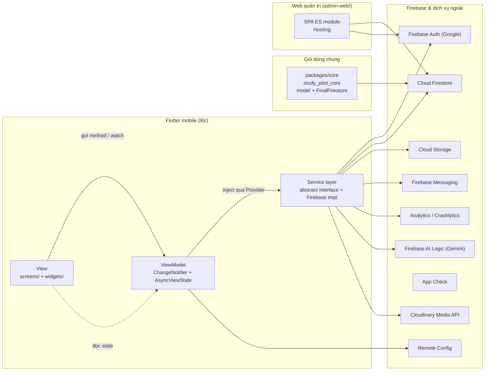
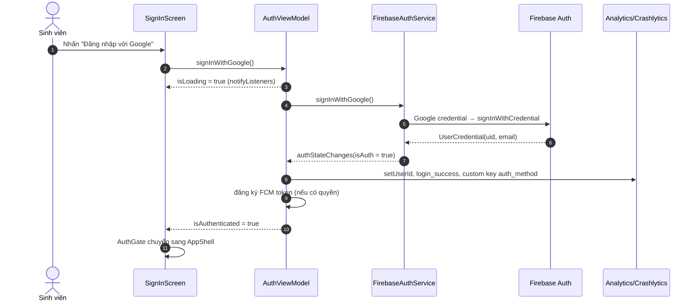
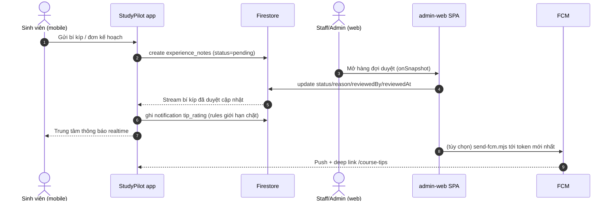

# Kiến trúc ứng dụng — StudyPilot (GR6)

Tài liệu mô tả kiến trúc **thực tế đang chạy trong repo** tại thời điểm bàn giao: ứng dụng Flutter (mobile), gói dùng chung `packages/core`, web quản trị tĩnh trên Firebase Hosting và các dịch vụ Firebase. Mọi sơ đồ dưới đây đối chiếu trực tiếp với mã nguồn, không phải thiết kế dự kiến.

## 1. Tổng quan các lớp



**Nguyên tắc cố định**

1. **Một chiều**: View → ViewModel → Service → Cloud. View không gọi SDK.
2. **Không gọi SDK trong View/ViewModel**: mọi truy cập `FirebaseAuth`, `FirebaseFirestore`, `FirebaseStorage`, `FirebaseAI`, `FirebaseMessaging` nằm sau interface trong `lib/services/`. Truy vấn dùng chung (bí kíp, đánh giá, bình luận, thông báo, đơn kế hoạch) nằm trong `FinalFirestore` của `packages/core`.
3. **Dependency injection**: composition root duy nhất là `lib/main.dart`. Widget test truyền service giả qua constructor `StudyPilotApp(...)`.
4. **Trạng thái tường minh**: `AsyncViewState<T>` có đúng bốn nhánh `loading / empty / data / error`; View bắt buộc render đủ bốn nhánh.
5. **Không dữ liệu giả**: khi Firebase không khởi tạo được, app hiển thị `FirebaseConfigErrorApp` thay vì âm thầm chạy mock. Các dịch vụ tùy chọn (App Check, Crashlytics, Remote Config, FCM) lỗi thì degrade và ghi log, không chặn app.

## 2. Cấu trúc thư mục thực tế

```
lib/
├── main.dart                      # Composition root: MultiProvider, AuthGate, routes
├── firebase/firebase_options.dart # Cấu hình Firebase Android
├── models/                        # Model thuần Dart
│   ├── app_state.dart             # ViewState + AsyncViewState<T>
│   ├── announcement_model.dart
│   ├── course_model.dart, course_progress.dart
│   ├── note_model.dart, note_draft.dart, note_attachment.dart
│   ├── notification_model.dart
│   ├── task_model.dart
│   └── academic_profile.dart
├── screens/                       # 18 màn hình (SCR-*)
├── viewmodels/
│   ├── base_viewmodel.dart        # BaseViewModel<T>: state, load/retry
│   ├── auth_viewmodel.dart
│   ├── notifications_viewmodel.dart
│   ├── roadmap_viewmodel.dart
│   ├── tasks_viewmodel.dart
│   ├── notes_viewmodel.dart
│   ├── academic_viewmodel.dart
│   ├── advisor_viewmodel.dart
│   └── announcements_viewmodel.dart
├── services/                      # Interface + Firebase implementation
│   ├── auth_service.dart / firebase_auth_service.dart
│   ├── firestore_service.dart / firebase_firestore_service.dart
│   ├── storage_service.dart / firebase_storage_service.dart
│   ├── report_media_storage_service.dart   # Adapter Cloudinary
│   ├── ai_service.dart                     # AiService + GeminiAiService
│   ├── analytics_service.dart / firebase_analytics_service.dart
│   ├── crashlytics_service.dart
│   ├── app_check_service.dart
│   ├── remote_config_service.dart
│   ├── messaging_service.dart / firebase_messaging_service.dart
│   ├── local_notification_service.dart
│   ├── report_pdf_service.dart / report_export_service.dart
│   ├── study_plan_ai.dart
│   └── sync_reload_service.dart
├── theme/                         # app_colors, app_spacing, app_theme
├── utils/                         # ai_failure_messages, version_utils
└── widgets/                       # AppButton, AppCard, AppLoading/Empty/ErrorState,
                                   # AppBottomNav, CommunityTipsSection, TaskEditorSheet...

packages/core/                     # Gói Dart dùng chung mobile + web payload
└── lib/study_pilot_core.dart      # StudyPlanSubmission, Announcement, ExperienceNote,
                                   # TipRating, TipComment, FinalFirestore

admin-web/                         # SPA tĩnh deploy qua Firebase Hosting
├── index.html, app.js, style.css
├── dashboard.js, course-payload.js, flm-parser.js
├── firebase-api.mjs, media-server.mjs, send-fcm.mjs, server.mjs
└── *.test.mjs                     # node --test cho parser và server

firebase/
├── firestore.rules                # Deny-by-default, RBAC theo users/{uid}.role
├── storage.rules                  # Owner-only, giới hạn 10MB theo loại tệp
├── firestore.indexes.json
├── remote-config-template.json    # 9 tham số, khớp default trong app
└── tests/                         # @firebase/rules-unit-testing

test/                              # Widget/unit test + fake services
e2e_test/                          # pytest + ARTEMIS (ADB) + Appium-UIAutomator
tool/                              # Script sinh báo cáo/slide PDF
docs/                              # Tài liệu bàn giao
```

## 3. Composition root và bảng Provider

`lib/main.dart` là nơi duy nhất dựng object graph:

| Provider | Kiểu | Ghi chú |
|---|---|---|
| `AuthService` | `FirebaseAuthService` | Google Sign-In; không chặn domain email |
| `FirestoreService` | `FirebaseFirestoreService` | Bật `persistenceEnabled` + `CACHE_SIZE_UNLIMITED` |
| `StorageService` | `FirebaseStorageService` | Đường dẫn `notes/{uid}/...`, `reports/{uid}/...` |
| `FinalFirestore?` | `packages/core` | `null` trong widget test; query dùng chung |
| `ReportMediaStorageService?` | Cloudinary adapter | Chỉ tạo khi có `--dart-define=REPORT_MEDIA_URL` |
| `AnalyticsService` | `FirebaseAnalyticsService` | Lọc PII trước khi ghi event |
| `AiService` | `GeminiAiService` | Firebase AI Logic; VM không import SDK |
| `MessagingService?` | `FirebaseMessagingService` | `null` khi test hermetic → tắt push, không giả lập |
| `CrashlyticsService` | `CrashlyticsService` | Bắt lỗi Flutter + platform, thu thập khi được bật |
| `LocalNotificationService?` | `null` trên nền tảng không hỗ trợ | Nhắc học theo lịch |
| `RemoteConfigService` | `ChangeNotifier` | 9 tham số, có default trong app |
| `ReportExportService` | Dựng từ media/storage/firestore | Xuất PDF + upload + lịch sử báo cáo |

ViewModel được tạo ngay sau service, không giữ tham chiếu SDK:

| ViewModel | Phụ thuộc | Trách nhiệm |
|---|---|---|
| `AuthViewModel` | `AuthService`, `AnalyticsService`, `CrashlyticsService`, `MessagingService?`, `FirestoreService` | Đăng nhập/đăng xuất, instrumentation một lần, đăng ký FCM token |
| `NotificationsViewModel` | `AuthService`, `FirestoreService`, `MessagingService?`, `AnalyticsService` | Trung tâm thông báo, đánh dấu đã đọc, định tuyến khi bấm |
| `RoadmapViewModel` | `AuthService`, `FirestoreService`, `AnalyticsService` | Lộ trình, chi tiết môn, điều kiện tiên quyết |
| `TasksViewModel` | `AuthService`, `FirestoreService`, `AnalyticsService` | CRUD việc cần làm, lọc theo môn/hạn |
| `NotesViewModel` | `AuthService`, `FirestoreService`, `StorageService`, `ReportMediaStorageService?`, `AnalyticsService` | Ghi chú, đính kèm, chọn kho lưu theo metadata |
| `AcademicViewModel` | `AuthService`, `FirestoreService` | Hồ sơ học vụ, chuyên ngành, tiến độ tín chỉ |
| `AdvisorViewModel` | `AcademicViewModel`, `RemoteConfigService`, `AnalyticsService`, `AuthService`, `AiService`, `FinalFirestore?` | AI advisor, prompt/model theo Remote Config, bí kíp đã duyệt |
| `AnnouncementsViewModel` | `FinalFirestore` | Stream thông báo realtime; tạo trong `AnnouncementsScreen` |

## 4. Luồng dữ liệu tiêu biểu

### 4.1 Đăng nhập Google



Huỷ chọn tài khoản không phải lỗi: service trả về sạch, UI hiện thông điệp "đã huỷ" và vẫn ở màn đăng nhập. Lỗi mạng hiện banner lỗi, không đẩy người dùng vào app.

### 4.2 Luồng liên vai trò (mobile → web → mobile)



Chi tiết hợp đồng dữ liệu và quyền ghi xem `docs/data-model.md` và `docs/cross-role-flow.md`.

### 4.3 Gọi AI (Advisor / Study Plan / Hỏi tài liệu)

1. ViewModel đọc `RemoteConfigService` để biết bật/tắt, model và prompt.
2. ViewModel gọi `AiService.generateText` hoặc `askDocument`.
3. `GeminiAiService` gọi Firebase AI Logic; lỗi được map sang thông điệp thân thiện trong `utils/ai_failure_messages.dart`.
4. Kết quả ghi Analytics `ai_request`, `ai_result_accepted`, `ai_error`; output luôn được gắn nhãn AI và cho phép chỉnh sửa trước khi lưu.
5. Không gửi PII: prompt chỉ chứa mã môn, ngữ cảnh học vụ và nội dung người dùng chủ động nhập.

## 5. Bản đồ dịch vụ Firebase

| Dịch vụ | Vai trò | Cấu hình trong repo |
|---|---|---|
| **Auth** | Đăng nhập Google | `FirebaseAuthService`; không ép domain `@fpt.edu.vn` (xem D-03 trong `design-traceability.md`) |
| **Firestore** | Dữ liệu chính | Offline persistence + cache không giới hạn; rules deny-by-default |
| **Cloud Storage** | Tệp ghi chú/báo cáo | `storage.rules`: owner-only, < 10MB, whitelist content-type |
| **Cloudinary Media API** | Lưu PDF báo cáo và đính kèm khi Spark không có bucket | `ReportMediaStorageService` + `admin-web/media-server.mjs`; xác minh Firebase ID token, không đưa credential sinh viên sang Cloudinary (D-02) |
| **FCM** | Push foreground/background/terminated | Token lưu `users/{uid}/tokens`; `send-fcm.mjs` gửi HTTP v1 |
| **Analytics** | ≥ 7 event + DebugView | `FirebaseAnalyticsService` lọc PII, có `ai_request/ai_result_accepted/ai_error` |
| **Crashlytics** | Lỗi thật + test crash | Global handler; bật thu thập tường minh khi demo/release |
| **Remote Config** | 9 tham số điều khiển hành vi | `maintenance_mode`, `min_app_version`, `feature_ai_advisor_enabled`, `ai_advisor_model`, `ai_advisor_prompt`, `study_plan_ai_enabled`, `study_plan_ai_model`, `study_plan_ai_prompt`, `vault_sync_interval_mins` |
| **App Check** | Chặn client lạ | Android debug provider với token debug ghim cho bản demo/sideload (xem D-07) |
| **Firebase AI Logic** | Gemini | Model mặc định `gemini-3.5-flash-lite`, đổi được từ Remote Config |

## 6. Web quản trị

`admin-web/` là SPA ES module thuần, không framework, deploy qua Hosting (`public: admin-web`). Bốn màn hình nghiệp vụ: **Chuyên ngành**, **Duyệt bí kíp**, **Thông báo**, **Dashboard**. Đăng nhập Google, rules chỉ cho `users/{uid}.role` là `staff`/`admin`; tài khoản sinh viên bị từ chối và tự đăng xuất.

- Dữ liệu đọc bằng `onSnapshot` (hàng đợi duyệt, bảng) và `getCountFromServer` (số liệu tổng hợp).
- Có scaffolding App Check, Analytics và Remote Config; lỗi từng màn hình hiện `#…-error` thay vì làm trắng trang.
- Các module Node (`server.mjs`, `media-server.mjs`, `send-fcm.mjs`) **không** được deploy lên Hosting — `firebase.json` loại trừ tường minh.

## 7. Bảo mật

### Firestore (`firebase/firestore.rules`)

- Mặc định từ chối toàn bộ (`match /{document=**} { allow read, write: if false; }`).
- `users/{uid}`: chủ sở hữu đọc/sửa hồ sơ của mình và **không được tự đổi `role`**; admin đổi `role` cho người khác, chỉ trường `role`, giá trị thuộc `user|staff|admin`.
- Subcollection riêng tư (`tasks`, `notes`, `sync`, `courseProgress`, `notifications`, `tokens`): chỉ chủ sở hữu. Ngoại lệ duy nhất: người chấm bí kíp được ghi **một** thông báo `tip_rating` vào hộp thư tác giả, với id/timestamp/route/recipient cố định.
- `courses`, `majors`, `curriculums`: mọi người dùng đã đăng nhập được đọc; `staff`/`admin` được ghi theo schema kiểm tra kiểu, độ dài, mã môn và id tài liệu.
- `experience_notes`: sinh viên tạo bản `pending`; chỉ `staff`/`admin` chuyển `pending → approved/rejected` và chỉ sửa 4 trường duyệt.
- `study_plan_submissions`: id cố định `{uid}_{semester}`; duyệt theo cùng nguyên tắc chuyển trạng thái.
- `tip_ratings`: id `{tipId}__{uid}` bảo đảm mỗi sinh viên một đánh giá; `tip_comments`: ai đăng nhập cũng bình luận, chỉ tác giả/admin xoá.
- `audit_logs`: append-only, chỉ ghi log của chính mình.

### Storage (`firebase/storage.rules`)

- `notes/{uid}/**` và `reports/{uid}/**`: owner-only, kích thước < 10MB, whitelist `image/png|jpeg`, `application/pdf`, `text/plain|markdown`, `docx`.

## 8. Xử lý lỗi và trạng thái

- **Khởi động**: `main()` cô lập từng bước App Check/Crashlytics/Remote Config trong `try/catch`; lỗi một dịch vụ không chặn phần còn lại.
- **Firebase không cấu hình**: `FirebaseConfigErrorApp` hiển thị lỗi cấu hình, không giả lập dữ liệu.
- **Màn hình**: mọi danh sách dùng `AppLoadingState`, `AppEmptyState`, `AppErrorState` có hành động thử lại.
- **AI**: lỗi timeout/quota/model được map sang thông điệp tiếng Việt; nút gửi mở lại, không treo spinner.
- **Đồng bộ**: `SyncVaultScreen` kiểm tra ghi/đọc Firestore bằng dữ liệu thật rồi **xoá bản ghi kiểm tra**, không để lại task rác.

## 9. Kiểm thử

| Tầng | Công cụ | Phạm vi |
|---|---|---|
| Unit/Widget | `flutter test` (fake service trong `test/helpers/`) | ViewModel, state 4 nhánh, routing, PDF builder |
| Rules | `@firebase/rules-unit-testing` + Firestore Emulator (`npm run test:emulator`) | Cho phép/từ chối theo vai trò và chuyển trạng thái |
| Web | `node --test` | `flm-parser`, `server` |
| E2E | pytest + ARTEMIS (ADB) + Appium-UIAutomator | Luồng thật trên thiết bị, có screenshot/trace |

Kết quả và bằng chứng xem `docs/test-report.md`; kịch bản xem `docs/test-plan.md`.
