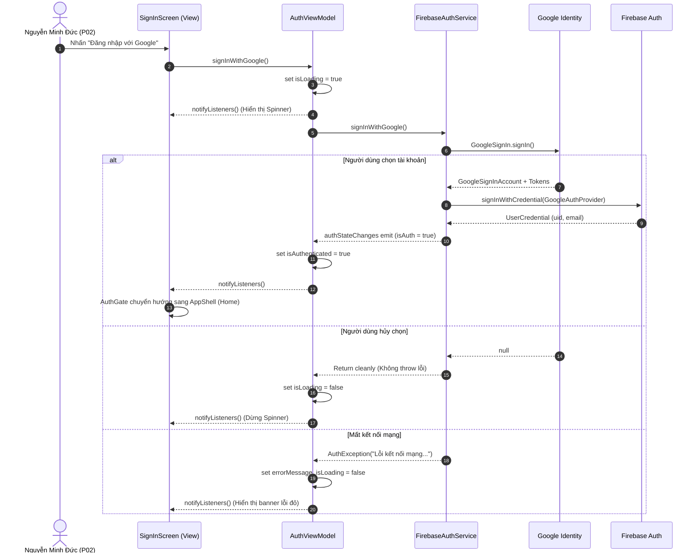

# Kiến trúc ứng dụng — FPTU Second Brain Mobile

## Tổng quan MVVM

```
┌──────────────┐      ┌───────────────┐      ┌──────────────────┐
│    VIEW      │ ←──→ │  VIEW MODEL   │ ←──→ │ SERVICE / REPO   │
│  (Widgets)   │      │ (ChangeNotif) │      │ (Firebase/API)   │
└──────────────┘      └───────────────┘      └──────────────────┘
    Flutter UI          State + Logic          Data layer
```

**Nguyên tắc cốt lõi (Graded Requirements)**:
1. **Luồng dữ liệu một chiều**: View → ViewModel → Service → Cloud.
2. **Không gọi trực tiếp SDK**: Widget tuyệt đối không gọi trực tiếp `FirebaseAuth`, `FirebaseFirestore`, hoặc `FirebaseStorage`.
3. **Dependency Injection**: Services được inject qua `Provider` tại root `MultiProvider` trong `main.dart`.
4. **Offline First**: Cloud Firestore được cấu hình `persistenceEnabled: true` với `CACHE_SIZE_UNLIMITED`.
5. **Sealed States**: Quản lý trạng thái qua `AsyncViewState<T>` với 4 trạng thái: Loading, Empty, Data, Error.

---

## Sơ đồ Sequence Diagram — Luồng Google Authentication



---

## Cấu trúc thư mục

```
lib/
├── main.dart                  # Entry point, MultiProvider, AuthGate, routes
├── firebase_options.dart      # Firebase configuration cho Android
├── models/
│   └── app_state.dart         # ViewState enum, AsyncViewState<T>
├── screens/
│   ├── sign_in_screen.dart    # SCR-00.01 — Đăng nhập Google
│   ├── home_screen.dart       # SCR-01.01 — Trang chủ & Vault Status
│   ├── roadmap_screen.dart    # SCR-02.01 — Lộ trình môn học
│   ├── course_detail_screen.dart  # SCR-02.02 — Chi tiết môn PRM323
│   ├── tasks_screen.dart      # SCR-03.01 — Việc cần làm & deadline
│   ├── notes_screen.dart      # SCR-04.02 — Danh sách ghi chú
│   ├── note_editor_screen.dart    # SCR-04.01 — Soạn thảo ghi chú
│   ├── advisor_screen.dart    # SCR-05.01 — Cố vấn học tập AI
│   ├── sync_vault_screen.dart # SCR-06.01 — Trạng thái đồng bộ Vault
│   └── sync_error_screen.dart # SCR-06.02 — Màn hình lỗi đồng bộ
├── viewmodels/
│   ├── base_viewmodel.dart    # BaseViewModel<T> + AsyncViewState
│   ├── auth_viewmodel.dart    # Quản lý Auth State & Google Sign-In
│   ├── home_viewmodel.dart
│   ├── roadmap_viewmodel.dart
│   ├── tasks_viewmodel.dart
│   └── notes_viewmodel.dart
├── services/
│   ├── auth_service.dart      # Interface Auth
│   ├── firebase_auth_service.dart  # Impl FirebaseAuth + GoogleSignIn
│   ├── mock_auth_service.dart      # Mock Auth cho Test / Offline
│   ├── firestore_service.dart # Interface Firestore
│   ├── firebase_firestore_service.dart # Impl Firestore + Offline cache
│   ├── mock_firestore_service.dart     # Mock Firestore cho Test
│   ├── storage_service.dart   # Interface Cloud Storage
│   ├── firebase_storage_service.dart   # Impl Cloud Storage (files/notes)
│   ├── analytics_service.dart # Interface Analytics
│   ├── firebase_analytics_service.dart # Impl Analytics (≥7 events, lọc PII)
│   ├── crashlytics_service.dart        # Impl Crashlytics (global unhandled error)
│   └── remote_config_service.dart      # Impl Remote Config (≥2 parameters)
├── theme/
│   ├── app_colors.dart        # 19 Design tokens màu sắc
│   ├── app_spacing.dart       # Spacing & Radius chuẩn M3
│   └── app_theme.dart         # ThemeData Material 3, font Inter
└── widgets/
    ├── app_button.dart        # AppButton (min 48dp, loading), AppOutlinedButton
    ├── app_components.dart    # AppCard, CustomAppBar (actions), AppConfirmDialog
    ├── app_navigation.dart    # AppBottomNav (4 tabs)
    ├── app_states.dart        # AppLoadingState, AppEmptyState, AppErrorState
    └── app_text_field.dart    # AppTextField, AppSearchBar

firebase/
├── firestore.rules            # Security rules (Strict owner RBAC, cấm open rules)
├── storage.rules              # Storage rules (Owner-only path, size limit 10MB)
└── seed_data.json             # Dữ liệu mẫu courses, tasks, notes (không có PII)
```

---

## Bảng ánh xạ ViewModel → Services

| ViewModel | Services Sử Dụng | Mục Đích |
|-----------|------------------|----------|
| `AuthViewModel` | `AuthService` | Đăng nhập Google, đăng xuất, theo dõi auth state stream |
| `HomeViewModel` | `FirestoreService`, `AnalyticsService` | Tải dữ liệu trang chủ, trạng thái đồng bộ vault |
| `RoadmapViewModel` | `FirestoreService`, `AnalyticsService` | Đọc danh sách môn học, kiểm tra điều kiện tiên quyết |
| `TasksViewModel` | `FirestoreService`, `AnalyticsService` | CRUD việc cần làm, lọc deadline theo môn |
| `NotesViewModel` | `FirestoreService`, `StorageService` | CRUD ghi chú học tập, upload đính kèm |

---

## Firebase Suite Configuration

| Service | Vai Trò | Cấu Hình Đặc Biệt |
|---------|---------|-------------------|
| **Firebase Auth** | Xác thực sinh viên | Google Sign-In, domain `@fpt.edu.vn` |
| **Cloud Firestore** | Cơ sở dữ liệu chính | `persistenceEnabled: true`, cache không giới hạn |
| **Cloud Storage** | Lưu trữ tệp ghi chú | Path: `notes/{userId}/...`, max size 10MB |
| **Firebase Analytics** | Đo lường hành vi | ≥7 events, bộ lọc loại trừ PII (name, email) |
| **Crashlytics** | Bắt lỗi ứng dụng | `FlutterError.onError` + `PlatformDispatcher.onError` |
| **Remote Config** | Cấu hình từ xa | 4 params: `maintenance_mode`, `feature_ai_advisor_enabled`, `min_app_version`, `vault_sync_interval_mins` |

---

## Security Rules

### Firestore Security Rules (`firebase/firestore.rules`)
- **Nguyên tắc**: Phân quyền nghiêm ngặt dựa trên `request.auth.uid == userId`.
- **Cấm tuyệt đối**: Không tồn tại bất kỳ quy tắc mở `allow read, write: if true;`.
- **Phân vùng dữ liệu**:
  - `users/{userId}/**`: Chỉ chủ sở hữu đọc/ghi.
  - `courses/**` & `curriculums/**`: Tất cả sinh viên đã xác thực được đọc (read-only), chỉ Admin được ghi.
  - `audit_logs/**`: Append-only, người dùng chỉ được tạo log của chính mình.

### Storage Security Rules (`firebase/storage.rules`)
- **Nguyên tắc**: Chỉ user được đọc/ghi thư mục `notes/{userId}/...` và `reports/{userId}/...`.
- **Giới hạn tệp**: Kích thước `< 10MB`, định dạng hợp lệ (ảnh, PDF, plain text).
