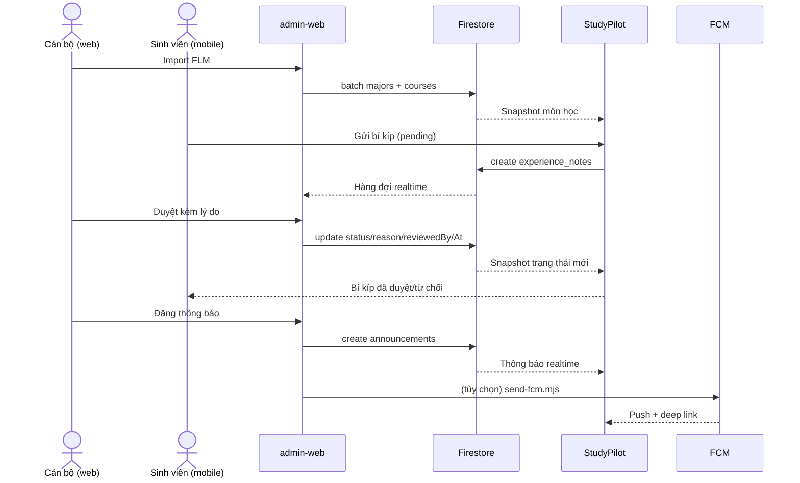

# Luồng liên vai trò: mobile → web → mobile

Tài liệu mô tả ba luồng bắt buộc của Final Assignment và cách hệ thống bảo đảm dữ liệu nhất quán mà không cần Cloud Functions.

## 1. Cán bộ nhập chương trình từ FLM (web)

**Tiền điều kiện**: tài khoản có `users/{uid}.role` là `staff` hoặc `admin`.

1. Mở **Chuyên ngành → Thêm chuyên ngành → Nhập từ file HTML FLM**.
2. Chọn một trang chương trình (`#gvSubs`) và các trang đề cương (`#gvSchedule`); được phép bỏ trống đề cương.
3. Web parse HTML tại trình duyệt, hiển thị trước danh sách môn, cảnh báo thiếu đề cương/tiên quyết, cho phép bỏ chọn từng môn.
4. Lưu bằng một batch: `majors/{code}` + `courses/{code}__{courseCode}`. Môn đã tồn tại được cập nhật tại chỗ, không nhân bản.
5. Mobile nhận snapshot môn học thật; không có dữ liệu seed/mock.

**Lỗi thường gặp**: file sai định dạng → preview rỗng và thông báo lỗi, không ghi Firestore; thiếu quyền → rules từ chối và web hiện banner lỗi.

## 2. Sinh viên gửi bí kíp (mobile)

1. Mở chi tiết môn → tab **Bí kíp cộng đồng** → **Gửi bí kíp**.
2. Nhập tiêu đề (≥ 3 ký tự), nội dung (≥ 20 ký tự), gợi ý giảng viên, lưu ý thi và mức hữu ích.
3. Mobile ghi `experience_notes/{id}` với `uid` của mình, `status: "pending"`, `createdAt: request.time`; rules kiểm tra môn tồn tại qua `exists(courses/{courseDocId})`.
4. Màn **Bí kíp của tôi** hiện trạng thái *Chờ duyệt*; sinh viên có thể xoá khi còn `pending`.

## 3. Cán bộ duyệt (web) và phản hồi realtime (mobile)

1. Web nghe `experience_notes` bằng `onSnapshot`, hiển thị hàng đợi theo trạng thái.
2. Cán bộ mở bí kíp, nhập lý do, chọn **Duyệt** hoặc **Từ chối**.
3. Rules chỉ cho cập nhật `status`, `reason`, `reviewedBy`, `reviewedAt` khi bản ghi `pending`; `reviewedBy` phải trùng UID người duyệt; `reviewedAt` phải là `request.time`.
4. Mobile đang mở màn nghe snapshot gồm bí kíp `approved` của môn và bí kíp của chính mình, nên thấy trạng thái/lý do **không cần refresh**.
5. Bí kíp đã duyệt hiển thị công khai và trở thành ngữ cảnh cho Cố vấn AI.

**Vì không có Cloud Functions**: việc duyệt không tự sinh push. Mobile phản hồi bằng snapshot Firestore; push chỉ dùng cho thông báo hệ thống hoặc hoạt động chấm bí kíp (mục 4).

## 4. Thông báo và hộp thư

- **Announcement**: staff/admin đăng `announcements` trên web → mobile đọc realtime ở **Thông báo hệ thống**; có thể kèm FCM do server gửi.
- **Tip activity**: khi một sinh viên chấm bí kíp, app ghi **một** notification vào hộp thư tác giả. Rules giới hạn chặt: type `tip_rating`, route `/course-tips`, `recipientId` là tác giả, `actorId` là người chấm, ID `tip_rating_<...>`.
- **FCM**: token lưu `users/{uid}/tokens`; `admin-web/send-fcm.mjs` gửi HTTP v1 tới token mới nhất (kiểm tra `validate_only` trước). Tap push chỉ mở route nằm trong whitelist của `NotificationModel.destinationRoute`.

## 5. Ma trận quyền

| Hành động | user | staff | admin |
|---|---|---|---|
| Đọc catalog/môn | ✅ | ✅ | ✅ |
| Ghi catalog/môn | ❌ | ✅ | ✅ |
| Gửi bí kíp | ✅ | ❌ | ❌ |
| Duyệt bí kíp | ❌ | ✅ | ✅ |
| Đọc bí kíp pending của người khác | ❌ | ✅ | ✅ |
| Đăng thông báo | ❌ | ✅ | ✅ |
| Đọc hồ sơ người khác | ❌ | ❌ | ✅ |
| Đổi role người khác | ❌ | ❌ | ✅ |

## 6. Ghi chú phạm vi

- `study_plan_submissions` vẫn còn trên mobile nhưng web **không** có màn duyệt; không tuyên bố luồng duyệt kế hoạch qua web.
- Điểm số do sinh viên tự nhập; admin chỉ quản lý chương trình và tiên quyết.
- Nút **Dọn dữ liệu cũ** trên web chỉ xoá `majors`, `courses`, `curriculums` sau khi gõ `XOA`.
- Bằng chứng chạy thật cho luồng này nằm trong `evidence/artemis/` khi E2E được chạy; hiện chưa có vì thiết bị đang khoá.
