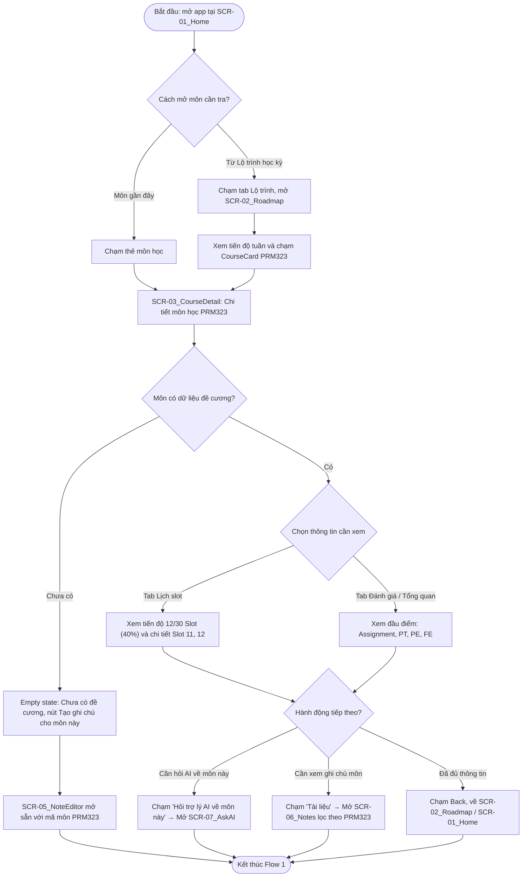
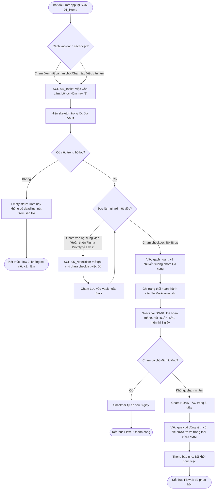
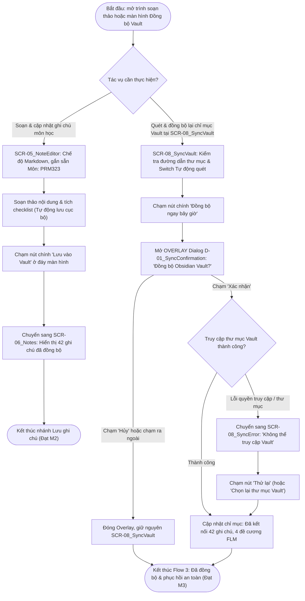
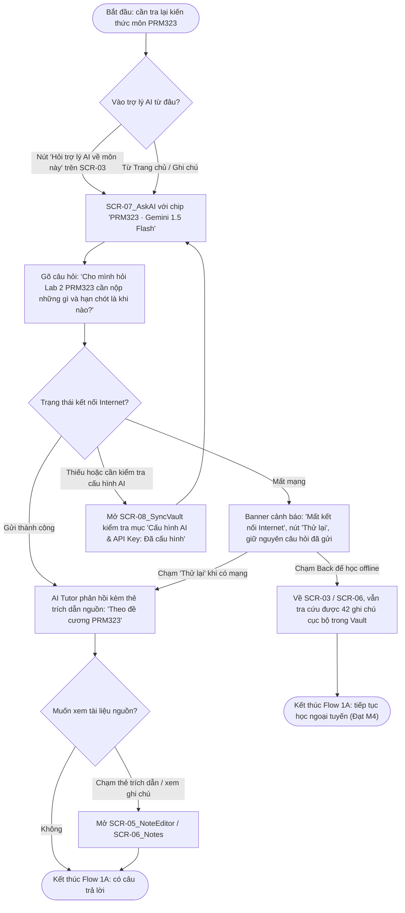

# UX ANALYSIS: INFORMATION ARCHITECTURE & USER FLOWS

> Tài liệu này bám theo `persona.md` (`P02 · Nguyễn Minh Đức`). Các mục tiêu của persona được ký hiệu **G1–G4**:
> G1 = Nắm cấu trúc và nội dung slot môn học · G2 = Tổng hợp công việc cần làm · G3 = Tra cứu ghi chú bài học · G4 = Ghi chép nhanh (Quick Capture).
> Các tiêu chí đo được **M1–M4** là bốn tiêu chí trong mục 5 của persona (M1 = tra cứu ≤ 8 giây và ≤ 3 chạm, M2 = tạo/lưu ghi chú deadline ≤ 15 giây, M3 = Undo trong Snackbar 8 giây & phục hồi lỗi đồng bộ, M4 = nhận diện lỗi mất mạng khi hỏi AI và chạm Thử lại giữ nguyên câu hỏi).

---

## 0. Phạm vi và Giả định của bản Mobile

- **Vai trò của app:** ứng dụng đồng hành, đọc/ghi Obsidian Vault cục bộ và tra cứu catalog học tập đã tải. Catalog ngành/đề cương dự kiến được đồng bộ lên cloud từ nguồn FLM được phép; sinh viên chọn ngành/khóa muốn tải về máy. Prototype dùng dữ liệu mẫu, không kết nối FLM thật.
- **Dữ liệu cá nhân:** FAP là tùy chọn và chỉ qua kênh chính thức được cấp quyền; bảng điểm/lịch/chuyên cần lưu cục bộ mặc định. Việc hỏi AI về dữ liệu cá nhân luôn có consent theo từng lần. Không cào dữ liệu FLM hoặc lưu mật khẩu đăng nhập.
- **Việc ngoài mobile prototype:** đồng bộ catalog backend thật, tích hợp FAP thật, vector hóa kho tri thức, tạo ngành/kỳ/môn, Hard Reset AI. Các luồng này chỉ được mô tả ở mức sản phẩm/handoff; không khẳng định Figma đang kết nối hệ thống trường.
- **Ngoại tuyến:** xem đề cương, xem và tick task, soạn ghi chú và quét lại chỉ mục Vault cục bộ đều dùng được vì chỉ đọc/ghi file trên thiết bị. **Trợ lý AI (`Gemini 1.5 Flash`) cần mạng để giải đáp câu hỏi mới.**
- **Ngoài phạm vi (ghi nhận để tránh bị hỏi khó):** xử lý xung đột khi một file bị sửa đồng thời trên laptop và điện thoại (do dịch vụ đồng bộ đảm nhiệm); thông báo nhắc deadline ngoài app; dark theme; chèn liên kết `[[...]]`.
- **Số lượng:** 8 màn hình cốt lõi Lab 2, 3 flow gốc và nhánh hỏi AI Flow 1A; Figma được mở rộng thêm Workflow 4–6 với 9 frame mới và 3 starting points mới. Tổng cộng 6 starting points ở `06 Prototype`; dialog, loading và error states được tính riêng, không tính là màn hình độc lập của persona.

- **Phân khúc persona:** ba flow Lab 2 gốc tiếp tục ưu tiên P02 · Nguyễn Minh Đức. Workflow 4/5 mở rộng hỗ trợ P01; Workflow 4/6 hỗ trợ P03. Figma hiển thị các màn hình mở rộng bằng dữ liệu mẫu; bảng điểm, điều kiện cá nhân và lịch thật chỉ kết luận khi có dữ liệu/nguồn chính thức đúng ngành/khóa.

### Crosswalk mã màn hình phân cấp

Các màn hình gốc được đổi từ mã phẳng sang mã theo module trên Figma. Những mã phẳng còn sót trong sơ đồ Mermaid là bí danh lịch sử của ba flow Lab 2; mã hiện hành dùng trong file Figma và handoff là:

| Bí danh flow gốc | Mã Figma hiện hành |
|---|---|
| `SCR-01_Home` | `SCR-01.01_Home` |
| `SCR-02_Roadmap` | `SCR-02.01_Roadmap` |
| `SCR-03_CourseDetail` | `SCR-02.02_CourseDetail` |
| `SCR-04_Tasks` | `SCR-03.01_Tasks` |
| `SCR-05_NoteEditor` | `SCR-04.01_NoteEditor` |
| `SCR-06_Notes` | `SCR-04.02_Notes` |
| `SCR-07_AskAI` | `SCR-05.01_AdvisorHub` |
| `SCR-08_SyncVault` / `SCR-08_SyncError` | `SCR-06.01_SyncVault` / `SCR-06.02_SyncError` |

Workflow 4–6 và các màn hình bổ sung được đặc tả ở [`academic-workflows.md`](academic-workflows.md).

---

## 1. Kiến trúc Thông tin (Information Architecture)

### 1.1. Danh sách 8 Màn hình

| Mã | Tên hiển thị trên UI | Cấp | Nội dung chính (theo thứ tự ưu tiên thị giác) | Trạng thái cần thiết kế |
| :--- | :--- | :---: | :--- | :--- |
| **SCR-01** (`SCR-01_Home`) | FPTU Second Brain Mobile (Trang chủ) | L1 (Tab 1) | (1) Thẻ chào Minh Đức & trạng thái kết nối 42 ghi chú Offline; (2) Danh sách **Hạn chót khẩn cấp** (`Lab 1 SWP391` Quá hạn, `Lab 2 PRM323` Hôm nay 23:59, nút "Xem tất cả hạn chót" → SCR-04); (3) Thẻ "Obsidian Vault Sẵn Sàng (42 Ghi chú)". AppBar có icon Đồng bộ/Cài đặt → SCR-08. | populated, loading (skeleton), empty (chưa kết nối Vault), banner ngoại tuyến |
| **SCR-02** (`SCR-02_Roadmap`) | Lộ trình môn học | L1 (Tab 2) | (1) Chip chọn kỳ (`Fall 2024 (Kỳ 5)`, `Kỳ 4 (Summer 2024)`) và ô tìm kiếm môn học; (2) Biểu đồ cột "Tiến độ học tập tuần" (`MiniChart`); (3) Danh sách thẻ môn học (`CourseCard`: `PRM323 - Lập trình Di động Đa nền tảng`, trạng thái **icon + nhãn chữ** "Đã tải về", tiến độ `Slot 12/30 (40%)`) → mở SCR-03. | populated, loading, empty, pressed state |
| **SCR-03** (`SCR-03_CourseDetail`) | PRM323 (Chi tiết môn học) | L2 | Thẻ thông tin môn học kèm thanh tiến độ `12/30 Slot (40%)` và banner vàng "Đang ngoại tuyến". Tab nội bộ: **Lịch slot** (mặc định) · **Đánh giá** (Assignment, Progress Test, PE, FE) · **Tổng quan**. Hai nút hành động đáy: "Hỏi trợ lý AI về môn này" → SCR-07 (gắn sẵn mã môn) và "Tài liệu" → SCR-06 (lọc theo môn). | populated, empty (môn chưa có đề cương), banner ngoại tuyến |
| **SCR-04** (`SCR-04_Tasks`) | Việc Cần Làm | L1 (Tab 3) | Bộ lọc: `Hôm nay (3)` · `Sắp tới (5)` · `Đã xong`. Thẻ tiến độ Sprint học kỳ `67%`. Nhóm "Khẩn cấp & Quá hạn" luôn nằm đầu danh sách. Mỗi dòng (`TaskItem`): checkbox (vùng chạm 48 × 48 dp, tách khỏi vùng chạm của dòng), tên việc, môn, hạn và nhãn chữ trạng thái. Chạm vào nội dung dòng mở SCR-05 chứa việc đó. | populated, loading (skeleton), empty theo từng bộ lọc, Snackbar hoàn tác |
| **SCR-05** (`SCR-05_NoteEditor`) | Soạn Thảo Ghi Chú | L2 (toàn màn hình, modal) | Chế độ **Tạo mới / Sửa**. Trạng thái "Tự động lưu vào Vault cục bộ · Đã đồng bộ offline", chip môn (`Môn: PRM323`) và tag (`#lab2 #figma`), vùng soạn thảo checklist Markdown. Thanh công cụ định dạng nằm sát đáy màn hình (vùng ngón cái) kèm nút chính **"Lưu vào Vault"** → SCR-06. | mới, sửa, đã tự động lưu, lỗi tên file, lưu thất bại |
| **SCR-06** (`SCR-06_Notes`) | Ghi chú | L1 (Tab 4) | Thẻ trạng thái "Obsidian Vault · 42 ghi chú · Sẵn sàng offline", ô tìm kiếm ghi chú và hàng chip lọc môn (`Tất cả (42)`, `PRM323 (14)`, `SWP391`). Danh sách `NoteCard` có huy hiệu chữ **USER NOTE** hoặc **FLM SYNC**. Chạm vào thẻ mở SCR-05. | populated, đang lọc theo môn, kết quả tìm rỗng, empty (chưa có ghi chú) |
| **SCR-07** (`SCR-07_AskAI`) | Trợ lý AI | L2 | Chip ngữ cảnh `PRM323 · Gemini 1.5 Flash (Google AI)`. Hội thoại hỏi đáp (RAG): bong bóng câu hỏi của sinh viên, câu trả lời Markdown kèm **thẻ trích dẫn nguồn** ("Theo đề cương PRM323"), ô nhập câu hỏi và banner cảnh báo "Mất kết nối Internet" kèm nút "Thử lại". | trống (gợi ý câu hỏi), đang tìm, có câu trả lời, không tìm thấy, lỗi mất mạng, lỗi cấu hình AI |
| **SCR-08** (`SCR-08_SyncVault`) | Cài đặt & Đồng bộ | L2 | Trạng thái kết nối 42 ghi chú & 4 đề cương FLM; đường dẫn thư mục Vault cục bộ (`/storage/emulated/0/Documents/Obsidian/FPTU`) và nút "Chọn thư mục khác"; công tắc `Switch` "Tự động quét lại Vault"; nút chính **"Đồng bộ ngay bây giờ"** (mở dialog xác nhận `D-01_SyncConfirmation`); mục "Cấu hình AI & API Key" (`Đã cấu hình`). **Không có** đăng nhập FLM. | mặc định (`SCR-08_SyncVault`), hộp thoại xác nhận (`D-01_SyncConfirmation`), lỗi không thể truy cập Vault (`SCR-08_SyncError`) |

### 1.2. Cấu trúc Điều hướng

Điều hướng chính dùng **Bottom Navigation Bar 4 điểm đến** cố định ở đáy 4 màn hình cấp 1 (`SCR-01`, `SCR-02`, `SCR-04`, `SCR-06`). Trên bản Figma cuối cùng, thao tác mở nhanh trình soạn thảo (`SCR-05`) được tích hợp trực tiếp khi chạm vào thẻ công việc/ghi chú (hoặc FAB tùy biến theo ngữ cảnh) để tránh đè lên thanh thông báo Snackbar `HOÀN TÁC` ở đáy màn hình 360 dp.

```text
App Root
├── [Navigation Bar - Cấp 1]  (nhãn hiển thị trên UI)
│   ├── Tab 1  Trang chủ       → SCR-01_Home     (mặc định)
│   ├── Tab 2  Lộ trình        → SCR-02_Roadmap
│   ├── Tab 3  Việc cần làm    → SCR-04_Tasks
│   └── Tab 4  Ghi chú         → SCR-06_Notes
│
└── [Màn hình cấp 2 & Overlay - push lên trên tab]
    ├── SCR-01 / SCR-02 (chạm thẻ môn PRM323) ──► SCR-03_CourseDetail
    │       ├── "Hỏi trợ lý AI về môn này"    ──► SCR-07_AskAI (kèm mã môn PRM323)
    │       └── "Tài liệu" / "Xem ghi chú"    ──► SCR-06_Notes (lọc theo môn)
    ├── SCR-01 ("Xem tất cả hạn chót")        ──► SCR-04_Tasks
    ├── SCR-04 (chạm nội dung việc) / SCR-06 (chạm NoteCard) ──► SCR-05_NoteEditor
    │       └── Nút "Lưu vào Vault"           ──► SCR-06_Notes
    └── SCR-01 (icon Đồng bộ/Cài đặt trên AppBar) ──► SCR-08_SyncVault
            └── Nút "Đồng bộ ngay bây giờ"    ──► [Overlay] D-01_SyncConfirmation
                    ├── Nút "Hủy"             ──► Đóng Overlay, giữ nguyên SCR-08_SyncVault
                    └── Nút "Xác nhận"        ──► SCR-08_SyncError (nếu lỗi quyền truy cập)
                            └── Nút "Thử lại" ──► Phục hồi về SCR-08_SyncVault
```

### 1.3. Quy tắc nút Back (dùng cho prototype và handoff)

| Tình huống | Hành vi Back |
| :--- | :--- |
| Đang ở tab chính khác Trang chủ (`SCR-02`, `SCR-04`, `SCR-06`) | Về `SCR-01_Home` (Trang chủ) |
| Đang ở Trang chủ (`SCR-01_Home`) | Thoát app |
| Màn cấp 2 (`SCR-03`, `SCR-05`, `SCR-07`, `SCR-08`) | Về đúng màn hình đã mở nó |
| Đang mở Overlay `D-01_SyncConfirmation` trên `SCR-08` | Chạm "Hủy" hoặc chạm vùng nền mờ bên ngoài → Đóng Overlay |
| Đang ở màn hình lỗi `SCR-08_SyncError` | Chạm "Thử lại" → Phục hồi về `SCR-08_SyncVault`; chạm Back → Về `SCR-01_Home` |
| `SCR-07_AskAI` khi mất mạng hoặc quay lại từ Cài đặt | Giữ nguyên câu hỏi đã gửi và ngữ cảnh môn học `PRM323` |

### 1.4. Quyết định về IA (có lý do bám persona)

1. **Cài đặt & Đồng bộ không chiếm một tab đáy.** Đây là màn hình thiết lập đường dẫn Vault và đồng bộ chỉ mục, trong khi persona mở app 5–8 lần/ngày chỉ để xem việc khẩn cấp và tra cứu slot học. Cài đặt & Đồng bộ được đặt thành icon góc phải trên AppBar.
2. **Ghi chú lên thành Tab 4.** Mục tiêu G3 ("tìm lại ghi chú mà không mở từng file") cần một điểm vào cấp cao nhất kèm thanh tìm kiếm và chip lọc môn học (`PRM323`, `SWP391`).
3. **Các nút hành động chính đặt ở cạnh đáy màn hình (Vùng ngón cái).** Nút "Hỏi trợ lý AI về môn này" (`SCR-03`), "Lưu vào Vault" (`SCR-05`) và "Đồng bộ ngay bây giờ" (`SCR-08`) đều nằm ở nửa dưới màn hình, giúp thao tác một tay trên xe bus dễ dàng và không che khuất thanh Snackbar `HOÀN TÁC`.
4. **Không đăng nhập/cào FLM trực tiếp từ mobile.** Catalog ngành/đề cương được đồng bộ lên cloud qua nguồn được phép; người dùng chọn catalog cần tải. FAP là kết nối cá nhân tùy chọn, chỉ triển khai qua kênh chính thức được trường cấp quyền. Cách này tách catalog khỏi dữ liệu transcript/lịch cá nhân.
5. **Trợ lý AI giữ ngữ cảnh môn học.** Khi mở từ `SCR-03_CourseDetail`, màn hình `SCR-07_AskAI` tự động gắn sẵn chip `PRM323 · Gemini 1.5 Flash`, giúp sinh viên hỏi ngay mà không cần gõ lại tên môn.

---

## 2. Ba User Flow chính và nhánh AI Retrieval bổ sung

Ba flow Lab 2 gốc tương ứng với ba prototype start point đầu (`G1, M1` → Flow 1; `G2, M3` → Flow 2; `G4, M2` → Flow 3). Hỏi AI (`G3, M4`) là nhánh Flow 1A khởi chạy từ SCR-03, không phải start point độc lập. Ba start point bổ sung (Flow 4–6) được đặc tả trong [`academic-workflows.md`](academic-workflows.md).

---

### Flow 1: Tra cứu Slot & Đầu điểm của Môn học (Syllabus Lookup) — G1, M1

- **Điểm bắt đầu:** mở app tại `SCR-01_Home` (Trang chủ).
- **Mục tiêu:** xem tiến độ slot, nội dung từng slot và các đầu điểm đánh giá của môn học `PRM323`.
- **Điểm kết thúc:** nắm được thông tin tại `SCR-03_CourseDetail` và chuyển sang hỏi AI / xem tài liệu môn, hoặc quay lại màn hình trước.



- **Happy path (M1):** `SCR-01_Home` → chạm tab "Lộ trình" (1 chạm) → `SCR-02_Roadmap` → chạm thẻ môn `PRM323` (2 chạm) → xem chi tiết slot và đánh giá tại `SCR-03_CourseDetail` (≤ 3 chạm, ≤ 8 giây).
- **Alternate A:** từ đáy `SCR-03_CourseDetail`, chạm nút "Hỏi trợ lý AI về môn này" → mở `SCR-07_AskAI` (gắn sẵn ngữ cảnh `PRM323`), hoặc chạm "Tài liệu" → mở `SCR-06_Notes`.
- **Alternate B (môn chưa có dữ liệu):** `SCR-03` hiện empty state với một hành động tạo ghi chú mới → `SCR-05_NoteEditor`.
- **Alternate C (ngoại tuyến):** khi mất mạng, `SCR-03_CourseDetail` hiện banner vàng "Đang ngoại tuyến · Dữ liệu đề cương lưu cục bộ trong Vault" nhưng nội dung đề cương và tiến độ `12/30 Slot (40%)` vẫn hiển thị đầy đủ để kiểm thử tiêu chí M1.

---

### Flow 2: Quản lý Deadline & Phục hồi khi Chạm nhầm (Task & Undo) — G2, M3
*(Flow có nhánh lỗi và phục hồi theo yêu cầu đề bài)*

- **Điểm bắt đầu:** mở app tại `SCR-01_Home` hoặc `SCR-04_Tasks`.
- **Mục tiêu:** xem việc cần làm trong ngày, mở xem/cập nhật nội dung công việc hoặc đánh dấu hoàn thành (kèm cơ chế hoàn tác nếu chạm nhầm).
- **Điểm kết thúc:** danh sách việc được cập nhật đúng, hoặc việc lỡ tick nhầm được khôi phục.



- **Happy path:** `SCR-01_Home` → chạm "Xem tất cả hạn chót" (hoặc tab Việc cần làm) → `SCR-04_Tasks` → chạm checkbox → Snackbar tự ẩn sau 8 giây → thay đổi được giữ.
- **Alternate A:** chạm vào nội dung dòng việc "Hoàn thiện Figma Prototype Lab 2" → mở `SCR-05_NoteEditor` hiển thị checklist tiêu chuẩn chấm điểm Lab 2 → bấm "Lưu vào Vault" sang `SCR-06_Notes` (hoặc Back về `SCR-04_Tasks`).
- **Alternate B (empty):** bộ lọc không có việc → empty state kèm hành động "Xem sắp tới".
- **Error & Recovery (M3):** do rung lắc trên xe bus, Đức chạm nhầm checkbox → Snackbar `SN-01` neo đáy trong **8 giây** → chạm **HOÀN TÁC** (1 chạm) → việc quay về đúng vị trí cũ, trạng thái chưa xong.
- **Phòng ngừa chạm nhầm:** checkbox có vùng chạm 48 × 48 dp và tách biệt khỏi vùng chạm mở chi tiết của dòng.

---

### Flow 3: Soạn Ghi chú Nhanh, Đồng bộ Vault & Phục hồi Lỗi (Quick Capture & Vault Sync) — G4, M2, M3

- **Điểm bắt đầu:** mở `SCR-05_NoteEditor` từ danh sách công việc/ghi chú, hoặc mở `SCR-08_SyncVault` từ icon góc phải AppBar trên `SCR-01_Home`.
- **Mục tiêu:** lưu nhanh nội dung checklist Markdown vào Vault cục bộ, và xác nhận quét đồng bộ chỉ mục Vault an toàn (có hộp thoại Overlay `D-01_SyncConfirmation` và nhánh phục hồi lỗi `SCR-08_SyncError`).
- **Điểm kết thúc:** file ghi chú được lưu vào `SCR-06_Notes` và kho lưu trữ tại `SCR-08_SyncVault` được đồng bộ thành công.



- **Happy path — Lưu ghi chú nhanh (M2):** Từ `SCR-04_Tasks` (hoặc `SCR-06_Notes`) mở `SCR-05_NoteEditor` → kiểm tra/gõ nội dung checklist Markdown (tự động lưu cục bộ) → chạm nút **"Lưu vào Vault"** ở cạnh đáy màn hình → chuyển sang `SCR-06_Notes` (hoàn thành ≤ 15 giây).
- **Tương tác Overlay bắt buộc (`D-01_SyncConfirmation`):** Tại `SCR-08_SyncVault`, chạm nút **"Đồng bộ ngay bây giờ"** sẽ mở hộp thoại **`D-01_SyncConfirmation`** (*"Đồng bộ Obsidian Vault?"*) dưới dạng **Centered Overlay** với 2 lựa chọn **"Hủy"** (đóng overlay) và **"Xác nhận"**.
- **Nhánh lỗi & phục hồi trực quan (`SCR-08_SyncError` — M3):**
  - Khi chạm **"Xác nhận"**, nếu xảy ra lỗi đọc thư mục, hệ thống chuyển sang màn hình **`SCR-08_SyncError`** (*"Không thể truy cập Vault"*).
  - Màn hình giải thích rõ nguyên nhân bằng ngôn ngữ dễ hiểu, cam kết *"Dữ liệu cục bộ được giữ nguyên (42 ghi chú, 4 đề cương đã lưu vẫn dùng offline)"* và cung cấp nút chính **"Thử lại"** để người dùng bấm phục hồi quay về `SCR-08_SyncVault`.
- **Ngoại tuyến:** toàn bộ quá trình đọc/ghi ghi chú và quét chỉ mục Vault trên thiết bị hoạt động 100% không cần Internet.

---

### Nhánh Flow 1A: Hỏi Trợ lý AI về Ghi chú & Phục hồi khi Mất mạng (AI Knowledge Retrieval) — G3, M4

- **Điểm bắt đầu:** cần tra lại kiến thức đã ghi; vào `SCR-07_AskAI` từ nút "Hỏi trợ lý AI về môn này" trên `SCR-03_CourseDetail` (hoặc từ Trang chủ / Ghi chú).
- **Mục tiêu:** nhận câu trả lời trích từ đề cương và ghi chú của chính mình (có dẫn nguồn), và xử lý phục hồi khi mất kết nối mạng.
- **Điểm kết thúc:** có câu trả lời kèm thẻ nguồn trích dẫn, hoặc bấm "Thử lại" / quay về đọc ghi chú ngoại tuyến.



- **Happy path:** Từ `SCR-03_CourseDetail` → chạm "Hỏi trợ lý AI về môn này" → `SCR-07_AskAI` → gửi câu hỏi → nhận câu trả lời từ `AI Tutor · Gemini 1.5 Flash` kèm thẻ nguồn **"Theo đề cương PRM323"**.
- **Nhánh lỗi & phục hồi khi mất mạng (Đạt tiêu chí M4):**
  - Khi mất kết nối Internet trên xe bus, `SCR-07_AskAI` hiển thị rõ banner vàng **"Mất kết nối Internet"** (*"Trợ lý AI cần mạng để giải đáp câu hỏi mới. Bạn vẫn có thể tra cứu 42 ghi chú cục bộ trong Vault"*), **không làm mất câu hỏi đã gửi** và cung cấp nút **"Thử lại"** ngay bên dưới để kết nối lại nhanh chóng.

---

## 3. Bảng Ánh xạ User Flow sang Màn hình

| Mã Frame | Màn hình | Cấp | Flow 1 Tra cứu | Flow 2 Deadline & Undo | Flow 3 Ghi chú & Đồng bộ Vault | Flow 1A Hỏi AI (nhánh) |
| :--- | :--- | :---: | :---: | :---: | :---: | :---: |
| **SCR-01** (`SCR-01_Home`) | Trang chủ | L1 | **X** (Start) | **X** (Điểm vào) | **X** (Điểm vào AppBar) | |
| **SCR-02** (`SCR-02_Roadmap`) | Lộ trình môn học | L1 | **X** | | | |
| **SCR-03** (`SCR-03_CourseDetail`) | Chi tiết môn học | L2 | **X** (Goal) | | | **X** (Điểm vào) |
| **SCR-04** (`SCR-04_Tasks`) | Việc Cần Làm | L1 | | **X** (Start / Goal) | **X** (Điểm xuất phát) | |
| **SCR-05** (`SCR-05_NoteEditor`) | Soạn Thảo Ghi Chú | L2 | **X** (Nhánh môn trống) | **X** (Nhánh mở file) | **X** (Goal) | **X** (Xem nguồn) |
| **SCR-06** (`SCR-06_Notes`) | Ghi chú | L1 | **X** (End, nhánh Tài liệu) | | **X** (End, đã lưu) | **X** (Tra cứu offline) |
| **SCR-07** (`SCR-07_AskAI`) | Trợ lý AI | L2 | **X** (Nhánh Hỏi AI) | | | **X** (Goal) |
| **SCR-08** (`SCR-08_SyncVault`) | Cài đặt & Đồng bộ | L2 | | | **X** (Start / Goal) | **X** (Kiểm tra cấu hình AI) |
| **`SCR-08_SyncError`** | Trạng thái lỗi đồng bộ | Biến thể | | | **X** (Nhánh lỗi & Phục hồi) | |
| **`D-01_SyncConfirmation`** | Dialog xác nhận đồng bộ | Overlay | | | **X** (Overlay bắt buộc) | |

Cả 8 màn hình chính cùng 2 khung biến thể/overlay đều được các flow sử dụng đầy đủ và đều truy cập được từ cấu trúc điều hướng ở mục 1.2.

### Truy vết từ Persona đến Flow

| Mục tiêu persona | Flow | Tiêu chí đo liên quan (trong `persona.md`) |
| :--- | :--- | :--- |
| **G1** Nắm cấu trúc và slot môn | **Flow 1** | **M1** (Tra cứu đề cương môn học ≤ 8 giây, ≤ 3 chạm ở chế độ ngoại tuyến) |
| **G2** Tổng hợp công việc | **Flow 2** | **M3** (Hoàn tác thao tác nhầm qua Snackbar trong 8 giây) |
| **G4** Ghi chép nhanh | **Flow 2 & Flow 3** | **M2** (Cập nhật checklist và bấm "Lưu vào Vault" ≤ 15 giây) |
| **G3** Tra cứu ghi chú & hỏi AI | **Flow 1A** (nhánh từ Flow 1) | **M4** (nhận diện lỗi mất mạng trên `SCR-07_AskAI`, giữ câu hỏi và thử lại thành công). M3 và overlay đồng bộ Vault thuộc Flow 3. |

---

## 4. Danh mục Overlay và Trạng thái (phục vụ Prototype và Handoff)

| Mã | Loại | Dùng ở | Ghi chú |
| :--- | :--- | :--- | :--- |
| **`D-01_SyncConfirmation`** | Dialog xác nhận (Overlay) | `SCR-08_SyncVault` (Flow 3) | **"Đồng bộ Obsidian Vault?"** với hai nút **"Hủy"** (Close overlay) và **"Xác nhận"** (chuyển sang `SCR-08_SyncError`). **Overlay bắt buộc trên Figma Prototype.** |
| **`SCR-08_SyncError`** | Màn hình trạng thái lỗi | Đặt cạnh `SCR-08_SyncVault` (Flow 3) | **"Không thể truy cập Vault"** kèm thông báo giữ nguyên dữ liệu cục bộ và nút chính **"Thử lại"** (phục hồi về `SCR-08_SyncVault`). |
| **SN-01** | Snackbar có hành động | `SCR-04_Tasks` (Flow 2) | "Đã hoàn thành" kèm nút **HOÀN TÁC**, hiển thị **8 giây**. |
| **LD-01** | Loading → kết quả | Page `05 Components` / `SCR-04`, `SCR-08` | Component `LoadingState` (3 thanh skeleton) hiển thị trong lúc đọc/quét chỉ mục Vault. |
| **EM-01…04** | Empty state | Page `05 Components` / `SCR-01`, `SCR-03`, `SCR-04`, `SCR-06` | Component `EmptyState` gồm icon, thông báo rõ ràng và đúng một nút hành động chính ("Tạo ghi chú"). |
| **ER-01…03** | Error state | `ER-01`: Banner "Mất kết nối Internet" kèm nút "Thử lại" (`SCR-07_AskAI`); `ER-03`: Không thể truy cập thư mục Vault (`SCR-08_SyncError`); lỗi nhập liệu dùng biến thể `Error` của `SearchField`. | Nêu rõ nguyên nhân bằng ngôn ngữ dễ hiểu và luôn có nút hành động phục hồi ("Thử lại"). |

---
